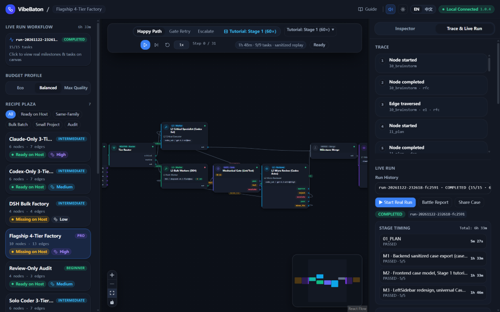
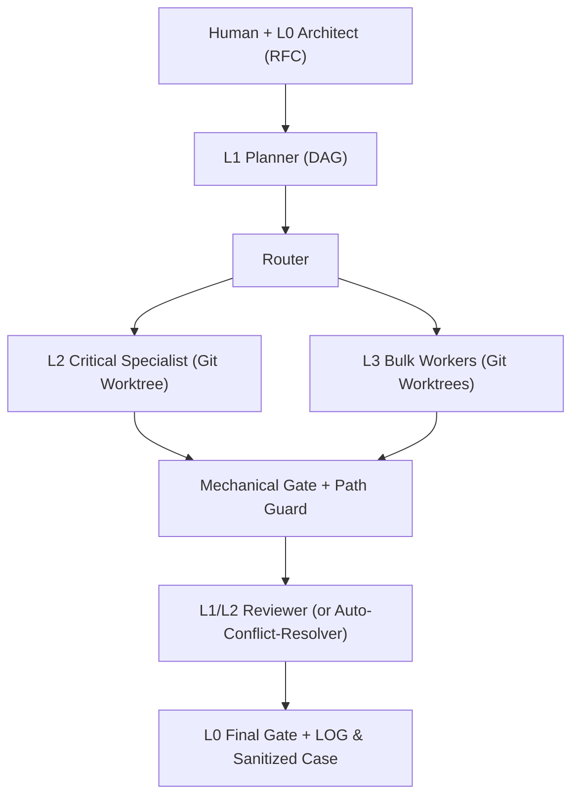
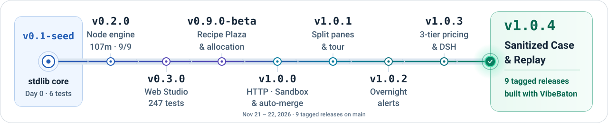
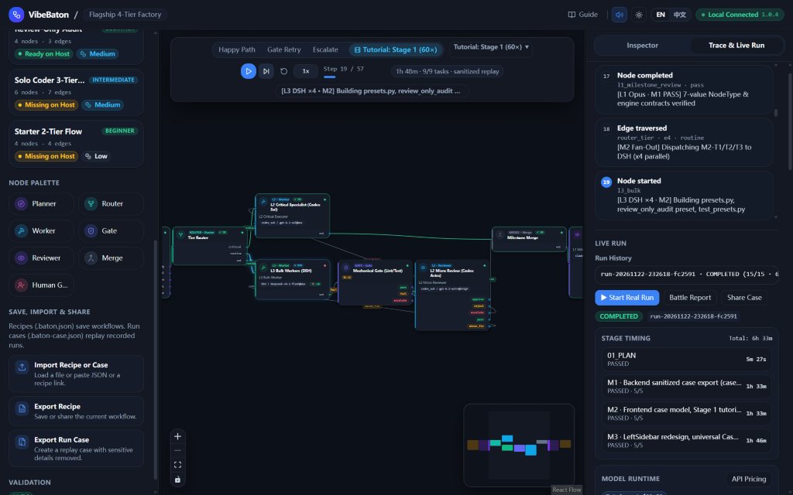
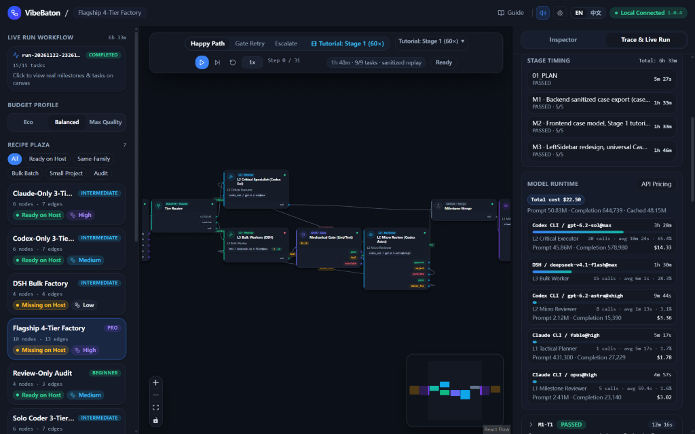

<div align="center">

**English** | [简体中文](README.zh-CN.md)

<picture>
  <source media="(prefers-color-scheme: dark)" srcset="./docs/assets/hero-dark.svg" />
  <source media="(prefers-color-scheme: light)" srcset="./docs/assets/hero-light.svg" />
  
</picture>

**Pass the baton. Ship the milestone.**

*VibeBaton grew from a zero-dependency stdlib seed (`v0.1-seed`) into `v1.0.4` by orchestrating Claude, Codex, DSH, and HTTP models on its own codebase — with a human L0 Architect steering direction and Final Gate sign-off.*

[](https://github.com/KungerChen/VibeBaton/releases)
[](https://github.com/KungerChen/VibeBaton/tree/v1.0.4/tests)
[](https://github.com/KungerChen/VibeBaton/blob/v1.0.4/LICENSE)
[](https://github.com/KungerChen/VibeBaton/blob/v1.0.4/pyproject.toml)
[](https://github.com/KungerChen/VibeBaton/blob/v1.0.4/docs/SECURITY.md)

[Quickstart](#quickstart) · [Studio gallery](#studio-gallery)

</div>

## The Proof — Stage 4.8 Self-Hosting Run (`v1.0.4`)

| **3 / 3** | **15 / 15** | **51.4M** | **\$22.50** | **1,068** |
| :---: | :---: | :---: | :---: | :---: |
| Milestones | Tasks | Tokens | Real Cost | Passing Tests |

*Observed from real self-hosting run `run-20261122-232618-fc2591`, inspectable inside Studio.*

**Token breakdown** · 50.83M prompt + 644,739 completion. **Test breakdown** · 536 Vitest + 532 Python unittest.

## VibeBaton in 30 Seconds

- **Heterogeneous relay.** Build a node-based coding workflow in Studio and choose Claude, Codex, DSH, or an OpenAI-compatible HTTP endpoint for each role.
- **Machine-first gates.** Run lint, type checks, tests, and a Git worktree path audit before spending tokens on AI review.
- **Safe dual-copy self-hosting.** Freeze the running engine with `baton promote-seed` while agents build the next release in a separate checkout. Share the result as a sanitized replay.



*Pick a budget and recipe, then follow the live task graph and stage timings from one screen.*

## How the Relay Works



## The Self-Hosting Timeline (`v0.1-seed` → `v1.0.4`)

Every release from `v0.2.0` to `v1.0.4` was built by VibeBaton orchestrating AI coding agents on its own repository — steered and signed off at milestone gates by a human L0 Architect.

<picture>
  <source media="(prefers-color-scheme: dark)" srcset="./docs/assets/timeline-dark.svg" />
  <source media="(prefers-color-scheme: light)" srcset="./docs/assets/timeline-light.svg" />
  
</picture>

<details>
<summary>Explore all 9 tagged releases</summary>

| Tag | What shipped |
| --- | --- |
| [`v0.1-seed`](https://github.com/KungerChen/VibeBaton/tree/v0.1-seed) | Zero-dependency Python 3.11+ stdlib core, an MCP server, and `baton promote-seed`. |
| [`v0.2.0`](https://github.com/KungerChen/VibeBaton/tree/v0.2.0) | The seed built the node-graph engine in 107 min. 3/3 milestones, 9/9 tasks, and 63 tests, up from 6. Zero runtime dependencies. |
| [`v0.3.0`](https://github.com/KungerChen/VibeBaton/tree/v0.3.0) | `canvas` shipped a zero-dependency HTTP/SSE server and React 19 Studio. 141 frontend + 106 backend = 247 tests. |
| [`v0.9.0-beta`](https://github.com/KungerChen/VibeBaton/tree/v0.9.0-beta) | Seven Recipe Plaza presets, Smart Allocation, Launch Gate, Live Sync, bilingual battle reports, and a three-arm benchmark harness. |
| [`v1.0.0`](https://github.com/KungerChen/VibeBaton/tree/v1.0.0) | Native HTTP and token/USD billing, Auto-Conflict-Resolver, Docker/DevContainer scaffolding, and [`scripts/install.ps1`](./scripts/install.ps1). |
| [`v1.0.1`](https://github.com/KungerChen/VibeBaton/tree/v1.0.1) | Resizable panes, one-second live clocks, a seven-step Spotlight Tour with local run data, and SVG/Mermaid guides. |
| [`v1.0.2`](https://github.com/KungerChen/VibeBaton/tree/v1.0.2) | Overnight alerts through webhooks and Windows Toast, plus a six-state Studio `AttentionBanner`. |
| [`v1.0.3`](https://github.com/KungerChen/VibeBaton/tree/v1.0.3) | Three-tier pricing with a 24h price-feed cache, CLI JSON/JSONL token billing, and unified DSH branding. |
| [`v1.0.4`](https://github.com/KungerChen/VibeBaton/tree/v1.0.4) | `baton export-case`, sanitized `.baton-case.json` bundles, and the Universal Case Replay Player. |

</details>

## Don't Trust Our README — Replay the Run

- **Recipe (`.baton.json`)** shares the workflow graph and model routing. Preview custom fields before sharing a file or `#recipe=` link.
- **Run Case (`.baton-case.json`)** shares a replay graph, trace, metrics, and redaction report. Four layers scrub secrets, anonymize host paths and usernames, redact emails and private IPs, and strip raw diffs and stack traces.

The built-in **Stage 1 Tutorial (1h 48m · 9/9 tasks)** is an interactive Case Replay. Open **Tutorial: Stage 1** in the top **PlaybackBar** to play, pause, or step through the self-hosting run. Use the same case picker to import a community `.baton-case.json` file. [Replay and sharing guide](docs/TUTORIAL.md)

| Stage 1 replay | Case export |
| :---: | :---: |
|  |  |

## Studio Gallery

<table>
  <tr>
    <td width="50%"><br /><sub><strong>Studio overview</strong> · Budget, recipes, and live canvas.</sub></td>
    <td width="50%"><br /><sub><strong>Run telemetry</strong> · See where time, tokens, and dollars went.</sub></td>
  </tr>
  <tr>
    <td width="50%"><br /><sub><strong>Case replay</strong> · Step through each handoff on the canvas.</sub></td>
    <td width="50%"><br /><sub><strong>Case sharing</strong> · Review the redaction checklist before export.</sub></td>
  </tr>
</table>

## Quickstart

**Install from the VibeBaton checkout.** You’ll need Python 3.11+ and Git. For Studio, install Node.js and prepare the frontend with `npm --prefix web ci`.

```powershell
.\scripts\install.ps1
.\.venv\Scripts\Activate.ps1
```

On Linux, run `python -m pip install -e .` in an active virtual environment, then `npm --prefix web run build` to build Studio.

**Open Studio from a trusted target Git repo.** Run `baton init` to create `.baton/baton.toml` and the starter RFC at `.baton/00_RFC.md`. Set up providers in the config, then check readiness and launch Studio.

```sh
baton doctor
baton ui
```

**Run overnight.** In a second terminal with the same environment, approve the RFC and start the detached run from the target repo. Get the run ID from `baton status` and substitute it for `<id>` when exporting.

```sh
baton run --repo . --rfc .baton/00_RFC.md --mode overnight --detach
baton status
baton export-case --repo . --run-id <id>
```

**Run untrusted repos in an isolated environment.** Generate the sandbox with a trusted `baton` installation. Review the generated or existing sandbox files before building. Inside the container, initialize and run from `/workspace` with providers configured for the container. [Sandbox setup and limits](docs/SECURITY.md#container-sandbox-stage-4-v100)

```sh
baton sandbox init --repo .
docker compose -f sandbox/docker-compose.yml run --build --rm vibebaton sh
```

<details>
<summary>Native HTTP Providers</summary>

Add a provider to `.baton/baton.toml` for an OpenAI-compatible `/v1/chat/completions` endpoint. For example, to route a role to DeepSeek over HTTP, set its `provider = "deepseek_http"` and use a model ID supported by your endpoint.

```toml
[providers.deepseek_http]
type = "http"
base_url = "https://api.deepseek.com/v1"
api_key_env = "DEEPSEEK_API_KEY"
```

```powershell
$env:DEEPSEEK_API_KEY = "YOUR_DEEPSEEK_API_KEY"
```

HTTP `429` responses and `Retry-After` headers feed the provider cooldown scheduler. Studio and battle reports show prompt, completion, and cached tokens along with model costs in USD.

</details>

<details>
<summary>3-Tier API Pricing</summary>

Rates resolve in `custom > official_cache > builtin` order. The official feed cache has a 24h refresh window. Use **API Pricing** in Studio to inspect a rate’s source or override rates per million input, output, or cached input tokens. HTTP and CLI JSON/JSONL usage feed run cost totals.

```sh
baton pricing sync --repo .
baton pricing show --repo .
```

</details>

<details>
<summary>Attention Alerts</summary>

Enable `[notifications]` in `.baton/baton.toml`. Webhook targets include Feishu, WeCom, DingTalk, Slack, Discord, and generic endpoints. You can also enable Windows Toast and a terminal bell. The Studio `AttentionBanner` surfaces approval requests, ready-for-final-gate runs, failures, pauses, long cooldowns, and test alerts.

Set `webhook_url_env` to an environment variable holding your webhook URL and send a test with `baton notify-test --repo .`. [Example configuration](baton.example.toml)

</details>

<details>
<summary>Antigravity MCP Integration</summary>

Add the VibeBaton server entry from the config snippet to Antigravity’s `mcp_config.json`. Replace `PYTHONPATH` with your checkout’s `<repo>/src` and pass `--repo` with the target repository path. With `baton` on the client’s PATH, you can also use `baton mcp --repo .` from the target repo. Copy the linked skill into Antigravity’s skills folder for the workflow. The stdio server exposes run health, status, logs, approvals, and the Final Gate package. [MCP config snippet](agy_integration/mcp_config.snippet.json) · [Antigravity skill](agy_integration/SKILL.md)

</details>

<details open>
<summary><strong>Honest Boundaries</strong></summary>

- **Provider billing.** Bring your own CLI subscriptions or API keys. Your providers bill you directly under your subscription or API plan.
- **Telemetry.** Each result describes a single observed VibeBaton self-hosting run. For reproducible three-arm comparisons, see the [benchmark harness](benchmarks/).
- **Worktree guard.** The Path Whitelist Guard is a post-hoc Git worktree audit and revert mechanism. Run unattended on the host only with trusted repositories and inspected dependencies. Use an OS-level sandbox for untrusted repos. Generate Docker or DevContainer scaffolding with `baton sandbox init`. [Security model](docs/SECURITY.md)
- **Human approval.** A human L0 Architect approves RFCs, plan amendments, and Final Gate merges. Keep `require_human_approval_at = ["rfc_signoff", "plan_amendment", "final_merge"]` enabled.

</details>

## Release History & Documentation

`v1.0.0` added native HTTP providers, auto-conflict resolution, the sandbox, and the Windows installer. `v1.0.1` refined Studio and the guided tour. `v1.0.2` added overnight alerts, `v1.0.3` added three-tier pricing and unified DSH branding, and `v1.0.4` shipped sanitized case export and universal replay. [GitHub Releases](https://github.com/KungerChen/VibeBaton/releases) · [Changelog](CHANGELOG.md) · [v1.0 launch notes](docs/RELEASE_NOTES_v1.0.md)

[Beginner tutorial](docs/TUTORIAL.md) · [Roadmap](docs/ROADMAP.md) · [Security model](docs/SECURITY.md)

## Contributing & License

From the project checkout, install the Python package and run the backend unittest suite and frontend Vitest suite.

```sh
python -m pip install -e .
python -m unittest discover -s tests -v
npm --prefix web ci
npm --prefix web test
```

VibeBaton is released under the [MIT License](LICENSE).
