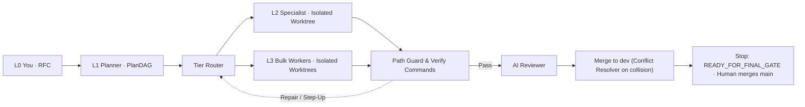
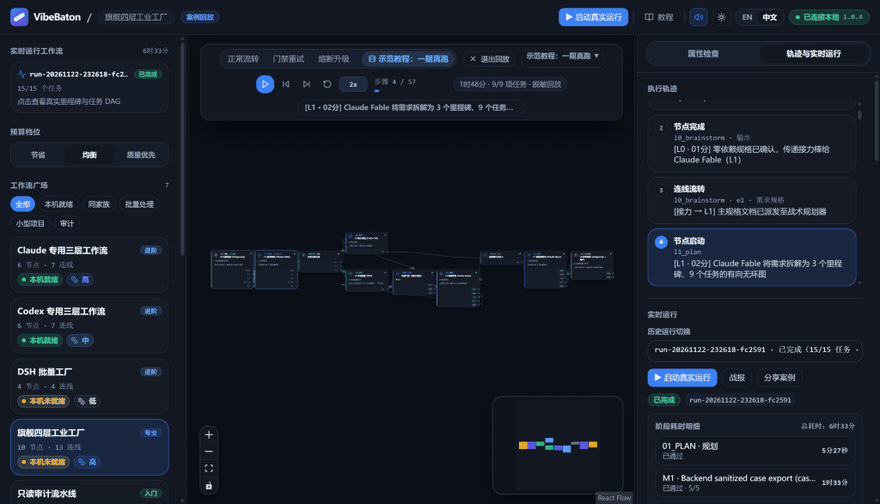
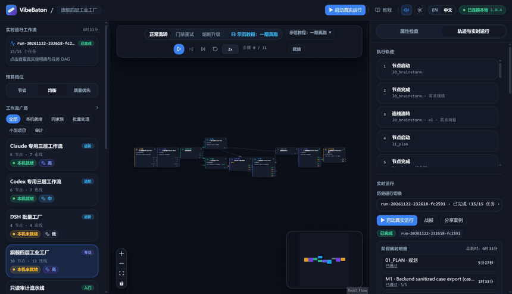
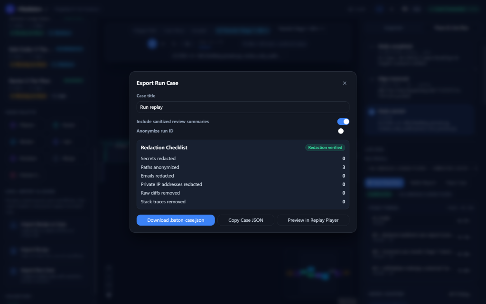

<div align="center">

**English** | [简体中文](README.zh-CN.md)

<picture>
  <source media="(prefers-color-scheme: dark)" srcset="./docs/assets/hero-dark.svg" />
  <source media="(prefers-color-scheme: light)" srcset="./docs/assets/hero-light.svg" />
  
</picture>

**VibeBaton (`baton`) is a local orchestrator for multi-model AI coding.**
Write a short RFC, assign Claude, Codex, DSH, or OpenAI-compatible HTTP models by role, isolate every task in a Git worktree, gate changes with real tests, and approve the final merge yourself.

*Every release from `v0.2.0` to `v1.2.0` was built this way on its own repo — orchestrated by VibeBaton with human direction and final sign-off.*

[](https://github.com/KungerChen/VibeBaton/releases)
[](#contributing--license)
[](LICENSE)
[](pyproject.toml)
[](#quickstart)

[What It Does](#what-vibebaton-does) · [How It Works](#how-the-relay-works) · [Replay a Run](#replay-a-real-run--before-you-trust-a-word) · [Quickstart](#quickstart)

</div>

## What VibeBaton Does

VibeBaton connects Studio on `127.0.0.1` and the `baton` CLI directly to the coding subscriptions and APIs you already use, with **zero runtime Python dependencies (`dependencies = []`)**. Design and simulate workflows on Studio's canvas, save role mappings to `.baton/baton.toml`, and launch RFC-driven runs (`PlanDAG` compiled from `.baton/00_RFC.md` or `--plan`) from Studio or your terminal.

| Everyday Multi-Agent Pain | Without VibeBaton | With VibeBaton (`baton`) |
| :--- | :--- | :--- |
| **Branch & file chaos** | Agents overwrite each other or edit unrelated files in one checkout. | Each task runs in `.baton/worktrees/task-*` with an `allowed_paths` audit/revert guard. |
| **"Done!" without testing** | Agents skip tests or burn review tokens on code that fails to compile. | Deterministic mechanical gates (`verify_cmd` & `gate_commands`) run before AI review when `machine_gate_before_ai_review = true`. |
| **Quota waste & `429` stalls** | Flagship quotas drain on boilerplate, or overnight runs die on rate limits. | Role-tier routing (Claude/Codex for planning/review, DSH for bulk coding; single-shot HTTP for planning/review) + per-provider SQLite `429` cooldown (`Retry-After` integer seconds) & bounded step-up. |
| **Parallel merge collisions** | Merging concurrent agent branches manually turns into conflict soup. | Auto-Conflict-Resolver isolates squash-merge collisions inside `_merge_*`, reconciles files, and re-runs gates. |
| **Black-box spend & time** | You cannot tell which step stalled or what different CLIs/APIs cost. | Live Stage Timing, CLI JSON/JSONL & HTTP 3-tier USD pricing, and bilingual Battle Reports. |


<p align="center"><em>Shown: Studio overseeing the Stage 4.8 release run (<code>v1.0.4</code>) — 3/3 milestones, 15/15 tasks in 6h 33m, 51.48M recorded tokens, $22.50 estimated across 34/49 billed calls (15 DSH calls omitted usage). Built with 1,068 suite tests (536 UI + 532 Python).</em></p>

## How the Relay Works

Think of VibeBaton as a **4×100m engineering relay with automated checkpoints**: a strong planner splits the RFC into scoped tasks, parallel workers code in isolated Git worktrees, deterministic tests guard every handoff, and you sign off before anything touches `main`.

- **`L0` · You + Host Architect:** Author the RFC and sign off the final merge from `dev` to `main`.
- **`L1` · Planner & Milestone Reviewer:** Compile `.baton/00_RFC.md` into a `PlanDAG` and audit completed milestones.
- **`L2` · Critical Specialist & Micro-Reviewer:** Handle complex edits and per-task reviews in isolated worktrees.
- **`L3` · Bulk Workers:** Implement standard modules and tests in parallel isolated worktrees (e.g., DSH).



## Specialist Panel Mode (v1.1.0)

For open-ended reviews instead of one fixed spec, `00_PANEL` runs first: read-only specialists audit the RFC in parallel, a Synthesizer merges their reports into one master spec, and `01_PLAN` plans from it. Specialists never edit the working tree — every change still passes the downstream gates.

- **Run it:** `baton run --repo . --rfc .baton/00_RFC.md --mode panel` (or `mode: "panel"` on `POST /api/runs/start`); per-specialist transcripts and the master spec land under `.baton/runs/<run_id>/panel/`.
- **Try the preset:** `specialist_panel` is the 8th Recipe Plaza preset — three specialists (UX & Copy, Visual & Structure, Source & Safety) feed a Synthesizer, then isolated workers, a mechanical gate, AI review, and human sign-off.
- **Cost-balanced defaults:** upper-mid models cover thinking and review while `eco` models synthesize and execute bulk work; set `[policies].budget_profile = "max_quality"` to escalate toward flagship. Configure lineups under `[panel]` / `[[panel.members]]` (see [baton.example.toml](baton.example.toml)).

## Guided Mode & CLI Registry (v1.2.0)

`v1.2.0` turns Studio into a single guided path from an empty folder to a signed-off run, scans the coding CLIs already on your machine, and explains each term in place.

- **Guided Mode:** a four-step closed loop — **Workspace** (pick a project folder and initialize Git if needed), **Blueprint** (chat about your idea until VibeBaton produces a Blueprint Card, then confirm it), **Build** (follow the task map, open each task in the detail drawer, and answer decisions in the app), and **Sign-Off** (Approve & Merge, Request Changes, or Roll Back after approval). Rollback reverts only this run's approved merge (while it is still the base head) to the base commit recorded at approval; the `baton-backup/<run_id>` tag stays as a manual recovery point.
- **Universal CLI Registry:** `presets/cli_registry.json` describes 8 coding-CLI drivers (`claude`, `codex`, `dsh`, `gemini`, `opencode`, `aider`, `qwen`, `copilot`). Studio scans which CLIs are installed and usable, recommends a lineup, and only installs a CLI or starts its login flow after you authorize it.
- **Tech Glossary:** 220+ `EN | 中文` terms across AI, engineering, errors, Git, web/HTTP, and VibeBaton concepts, shown as inline term hints and in a searchable glossary drawer.
- **New REST endpoints:** `GET /api/cli-registry`, `POST /api/cli-registry/scan`, `POST /api/cli-registry/install`, `POST /api/cli-registry/login`, `GET /api/workspace/info`, `POST /api/workspace/select`, `POST /api/workspace/init-git`, `POST /api/brainstorm/chat`, `POST /api/brainstorm/confirm`, `GET /api/runs/{id}/tasks/{task_id}`, and `POST /api/runs/{id}/finalize`.

## Right Tool for the Job

| Use Single Chat / IDE Agent When... | Use VibeBaton When... |
| :--- | :--- |
| Fixing a typo, tweaking one file, or exploring unfamiliar code. | Shipping a multi-file feature, refactor, or test expansion with clear pass/fail commands. |
| The task takes under 5 minutes of tight interactive editing. | Mixing flagship planning/review models with fast parallel coding workers. |
| Your repo has no automated build, lint, or test commands yet. | Running overnight or background work resilient to `429` limits, branch collisions, and scope drift. |

*Zero-key preview: launch Studio (`baton ui`) to simulate `happy_path`, `gate_retry`, and `escalate` offline and explore **8 Ready-on-Host Recipe Presets**.*

## Self-Hosting Evolution (`v0.1-seed` → `v1.2.0`)

VibeBaton built `v0.2.0` through `v1.2.0` by orchestrating Claude, Codex, and DSH on its own codebase under human direction and final sign-off.

<picture>
  <source media="(prefers-color-scheme: dark)" srcset="./docs/assets/timeline-dark.svg" />
  <source media="(prefers-color-scheme: light)" srcset="./docs/assets/timeline-light.svg" />
  
</picture>

<details>
<summary>Explore all 9 tagged releases</summary>

| Tag | Date | Highlights |
| :--- | :--- | :--- |
| [`v0.1-seed`](https://github.com/KungerChen/VibeBaton/tree/v0.1-seed) | 2026-11-21 | Zero-dependency Python 3.11+ stdlib core, SQLite WAL state machine, MCP server, and `baton promote-seed --dest <dir>`. |
| [`v0.2.0`](https://github.com/KungerChen/VibeBaton/tree/v0.2.0) | 2026-11-21 | Built node-graph engine in 107m (`3/3` milestones, `9/9` tasks, `63` tests up from `6`), zero runtime deps. |
| [`v0.3.0`](https://github.com/KungerChen/VibeBaton/tree/v0.3.0) | 2026-11-21 | Codename `canvas`: stdlib HTTP/SSE server and React 19 Studio (`141` UI + `106` Python = `247` tests). |
| [`v0.9.0-beta`](https://github.com/KungerChen/VibeBaton/tree/v0.9.0-beta) | 2026-11-22 | 7 Recipe Plaza presets, Smart Allocation, Launch Gate, Live Sync, bilingual Battle Reports, and `benchmarks/`. |
| [`v1.0.0`](https://github.com/KungerChen/VibeBaton/tree/v1.0.0) | 2026-11-22 | Native HTTP providers, token/USD billing, Auto-Conflict-Resolver, `sandbox init`, and [`scripts/install.ps1`](scripts/install.ps1). |
| [`v1.0.1`](https://github.com/KungerChen/VibeBaton/tree/v1.0.1) | 2026-11-22 | Resizable split panes, 1s live clocks, 7-step Spotlight Tour, and Mermaid/SVG architecture guides. |
| [`v1.0.2`](https://github.com/KungerChen/VibeBaton/tree/v1.0.2) | 2026-11-22 | Overnight webhook/Toast alerts and 6-state Studio `AttentionBanner`. |
| [`v1.0.3`](https://github.com/KungerChen/VibeBaton/tree/v1.0.3) | 2026-11-22 | 3-tier API pricing (`custom > official_cache > builtin`), CLI JSON/JSONL usage billing, and unified DSH branding. |
| [`v1.0.4`](https://github.com/KungerChen/VibeBaton/tree/v1.0.4) | 2026-11-22 | `baton export-case`, 4-layer redaction `.baton-case.json` bundles, and Universal Case Replay Player. |

Full notes in [CHANGELOG.md](CHANGELOG.md). Dual-copy self-hosting uses `baton promote-seed --dest <dir>` to recreate an isolated runner snapshot.

</details>

## Replay a Real Run — Before You Trust a Word

- **Recipes (`.baton.json` / `#recipe=` URL)** share your workflow topology and role routing with zero run history.
- **Run Cases (`.baton-case.json`)** export a replayable graph, trace, metrics, and redaction audit. Fresh clones ship the built-in **Stage 1 Tutorial (`1h 48m · 9/9 tasks`)** runnable out of the box with zero API keys (local Stage 4.8 SQLite state is gitignored).

<table><tr>
  <td width="50%"><br /><sub><strong>Case Replay (16 FPS):</strong> Stage 1 tutorial driving relay baton particles, gate retries, and synchronized trace.</sub></td>
  <td width="50%"><br /><sub><strong>Run Telemetry:</strong> Per-stage clocks (<code>6h 33m</code>), token counters, and <code>$22.50</code> modeled across <code>34/49</code> billed CLI calls.</sub></td>
</tr><tr>
  <td width="50%"><br /><sub><strong>Liquid Theme &amp; Workbench (16 FPS):</strong> 3-pane topology canvas with animated Dark/Light liquid pour transitions.</sub></td>
  <td width="50%"><br /><sub><strong>Live 20-Node DAG &amp; Redaction Gate (16 FPS):</strong> Switch into a real run graph and inspect clean 4-layer redaction before exporting.</sub></td>
</tr></table>

<details>
<summary>4-Layer Redaction &amp; Export Case Preview</summary>

<p align="center"></p>

Export with `baton export-case --repo . --run-id <id>` (add `--no-reviews` to omit review summaries, or `--anonymize --out <file>` to anonymize IDs and filename). Four pattern layers scrub: **(1)** secrets/API keys, **(2)** host paths & usernames, **(3)** emails & private IPv4 addresses, and **(4)** raw diffs & stack traces. CLI and Studio block export unless `redaction_report.clean == true`, verifying pattern rules rather than guaranteeing arbitrary prose has zero PII.
</details>

## Quickstart

1. **Install** — Python 3.11+ (`dependencies = []` for `baton` CLI/server) and Git; Studio frontend requires `Node 20+`:
   - **Windows** ([`scripts/install.ps1`](scripts/install.ps1)): `.\scripts\install.ps1` then `.\.venv\Scripts\Activate.ps1` · **Linux / macOS**: `python -m pip install -e .`
   - **Studio UI build**: `npm --prefix web ci && npm --prefix web run build`
2. **Inspect & Launch Studio (Zero-Key Tour Ready)** — Run `baton ui` immediately (or `baton ui --app` for a chromeless standalone desktop window, or double-click [`VibeBaton-Studio.bat`](VibeBaton-Studio.bat) on Windows) even before keys to play the Stage 1 tutorial or offline simulator:
   ```sh
   baton init --repo . && baton doctor --repo .
   baton ui --app
   ```
   *Windows Desktop Shortcut:* run `.\scripts\launch-studio.ps1 -CreateShortcut` once to pin a one-click **VibeBaton Studio** icon with the app badge onto your Desktop.
3. **Run Overnight & Export Case** (in a committed target Git repo with providers configured):
   ```sh
   baton run --repo . --rfc .baton/00_RFC.md --mode overnight --detach
   baton status && baton export-case --repo . --run-id <id>
   ```

> [!WARNING]
> **Running on an untrusted repository?** Generate the container scaffold first with `baton sandbox init --repo .` and inspect the files before building — see [docs/SECURITY.md](docs/SECURITY.md).

<details>
<summary>Container Sandbox (<code>baton sandbox init</code>)</summary>

`baton sandbox init --repo .` generates Docker Compose and DevContainer files that mount `/workspace` only (no `~/.ssh`), drop all Linux capabilities, set `no-new-privileges`, run as non-root `baton`, and use a read-only rootfs in Compose (`tmpfs` `/tmp` & cache; DevContainer omits RO rootfs). The archive ships Python/CLI assets without `web/dist` or provider CLIs — configure container providers before running `docker compose -f sandbox/docker-compose.yml run --build --rm vibebaton sh`.
</details>
<details>
<summary>Native HTTP Providers (<code>type = "http"</code>)</summary>

OpenAI-compatible `/v1/chat/completions` providers make single-shot calls ideal for planning and text review (code-editing workers use editing CLIs like `claude`, `codex`, or `dsh`). Add to `.baton/baton.toml` and set `$env:DEEPSEEK_API_KEY = "YOUR_DEEPSEEK_API_KEY"`:
```toml
[providers.deepseek_http]
type = "http"
base_url = "https://api.deepseek.com/v1"
api_key_env = "DEEPSEEK_API_KEY"
```
Note: `baton doctor` validates HTTP endpoints and API keys directly (and tests them with `--role`). `Retry-After` parses integer seconds.
</details>
<details>
<summary>3-Tier API Pricing (<code>baton pricing</code>)</summary>

Rates resolve in `custom > official_cache > builtin` order with a 24h official feed cache window and feed both CLI JSON/JSONL and HTTP run totals. Refresh and inspect via `baton pricing sync --repo .` and `baton pricing show --repo .`.
</details>
<details>
<summary>Overnight Webhook &amp; Desktop Alerts (<code>baton notify-test</code>)</summary>

Configure `[notifications]` in `.baton/baton.toml` for Feishu, WeCom, DingTalk, Slack, Discord, generic webhooks, Windows Toast, and terminal bell (`AttentionBanner` surfaces 6 attention states in Studio). Test delivery with `baton notify-test --repo .` (see [baton.example.toml](baton.example.toml)).
</details>
<details>
<summary>Antigravity MCP Server (<code>baton mcp</code>)</summary>

Expose all 9 MCP control-plane tools (`baton_health`, `baton_start`, `baton_status`, `baton_logs`, `baton_resolve`, `baton_control`, `baton_final_package`, `baton_list_presets`, `baton_validate_graph`) via `baton mcp --repo <path>` or `<repo>/src` in [agy_integration/mcp_config.snippet.json](agy_integration/mcp_config.snippet.json) · [agy_integration/SKILL.md](agy_integration/SKILL.md).
</details>

## Honest Boundaries

- **Your keys & bills:** Local execution with zero markup; providers bill your accounts directly. Recorded `$22.50` / `51.48M` metrics reflect one Stage 4.8 run (`run-20261122-232618-fc2591`) on `34/49` billed CLI calls; [`benchmarks/`](benchmarks/) defaults to `--mock` and takes `--live` for live model comparisons.
- **Guardrail ≠ Kernel Sandbox:** Path Whitelist Guard runs post-turn via Git worktrees. Run host pipelines on trusted repositories only; use `baton sandbox init` ([Security Model](docs/SECURITY.md)) for untrusted repos.
- **Clear tests win:** Best suited to multi-file changes backed by real build, lint, or test commands; quick one-file tweaks are faster in a single chat.
- **Human at the wheel:** Milestones collect on `dev` (`READY_FOR_FINAL_GATE`) and never touch `main` until an operator or L0 Architect reviews and merges (`PLAN_AMENDMENT` pauses in `WAITING_HUMAN`; `[policies].require_human_approval_at` records project gate policy).

## Releases & Docs

`v1.0.0` introduced native HTTP providers, Auto-Conflict-Resolver, container scaffolding, and the Windows installer, followed by `v1.0.1`–`v1.0.4` adding resizable panes, overnight alerts, 3-tier pricing, and sanitized case replay. `v1.1.0` added Specialist Panel mode, and `v1.2.0` adds Guided Mode, the Universal CLI Registry, and the bilingual tech glossary.  
[GitHub Releases](https://github.com/KungerChen/VibeBaton/releases) · [CHANGELOG](CHANGELOG.md) · [v1.0 Launch Notes](docs/RELEASE_NOTES_v1.0.md) · [Tutorial](docs/TUTORIAL.md) · [Roadmap](docs/ROADMAP.md) · [Security](docs/SECURITY.md)

## Contributing & License

```sh
python -m unittest discover -s tests -v
npm --prefix web ci && npm --prefix web test
```

Python tests conditionally skip host-specific Docker, Windows symlink, and untracked local SQLite checks when unavailable. Released under the [MIT License](LICENSE).
