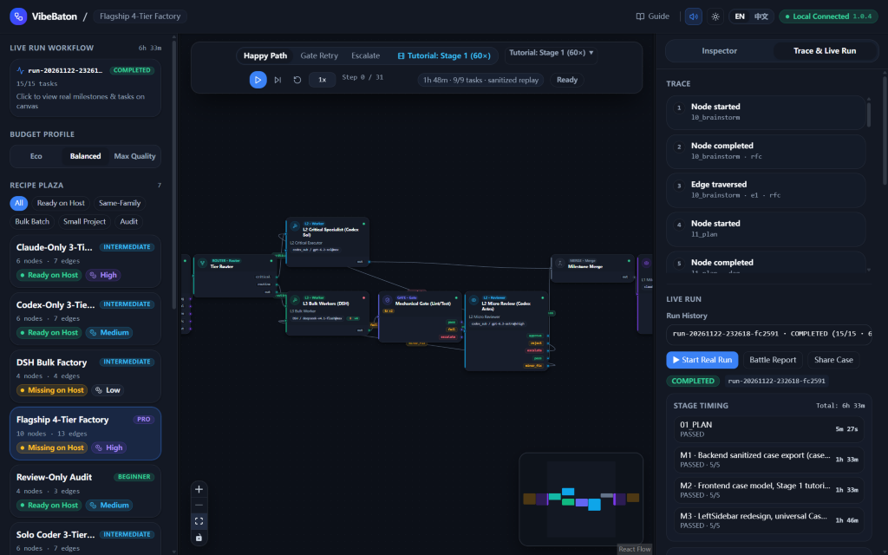
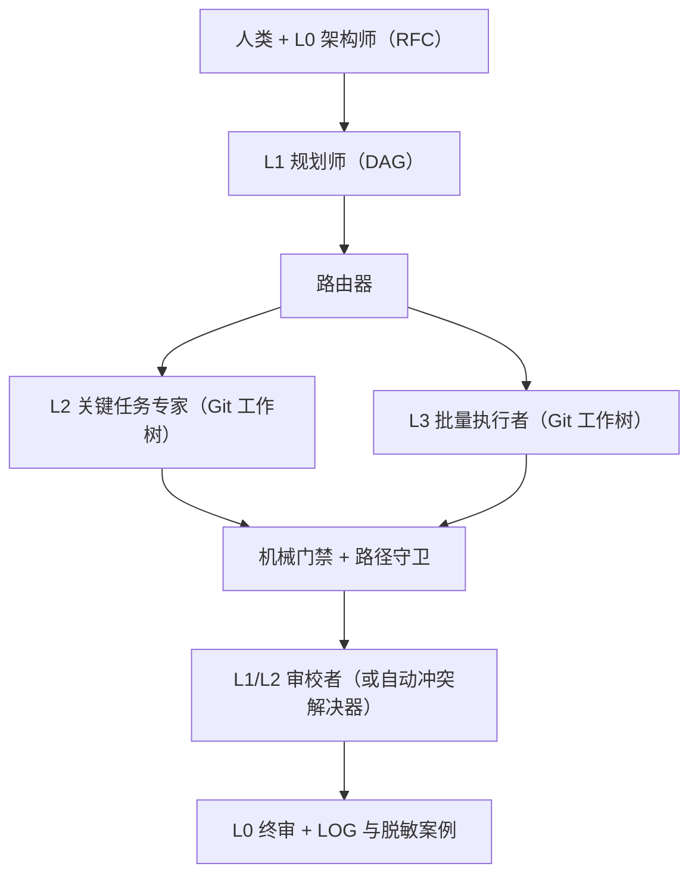
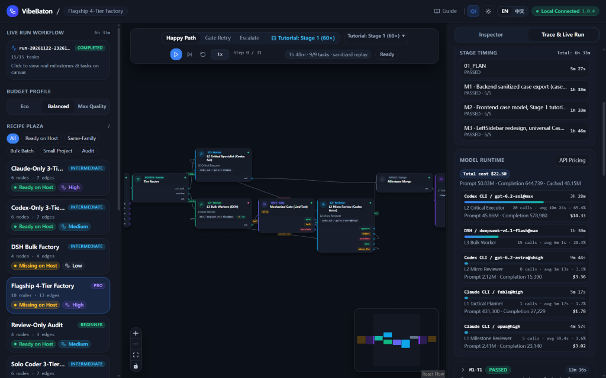

<div align="center">

[English](README.md) | **简体中文**

<picture>
  <source media="(prefers-color-scheme: dark)" srcset="./docs/assets/hero-dark.svg" />
  <source media="(prefers-color-scheme: light)" srcset="./docs/assets/hero-light.svg" />
  
</picture>

**传棒接力，交付里程碑。**

*VibeBaton 从零依赖的 Python 标准库种子 `v0.1-seed` 起步，在自己的代码库上调度 Claude、Codex、DSH 和 HTTP 模型，一路迭代到 `v1.0.4`。人类 L0 架构师把控方向，并在 Final Gate 签核。*

[](https://github.com/KungerChen/VibeBaton/releases)
[](https://github.com/KungerChen/VibeBaton/tree/v1.0.4/tests)
[](https://github.com/KungerChen/VibeBaton/blob/v1.0.4/LICENSE)
[](https://github.com/KungerChen/VibeBaton/blob/v1.0.4/pyproject.toml)
[](https://github.com/KungerChen/VibeBaton/blob/v1.0.4/docs/SECURITY.md)

[快速开始](#快速开始) · [Studio 图集](#studio-图集)

</div>

## Stage 4.8 自举实录（`v1.0.4`）

| **3 / 3** | **15 / 15** | **51.4M** | **\$22.50** | **1,068** |
| :---: | :---: | :---: | :---: | :---: |
| 里程碑 | 任务 | Tokens | 真实成本 | 通过测试 |

*数据来自真实自举运行 `run-20261122-232618-fc2591`，可在 Studio 中查看。*

**Token 明细** · 50.83M 输入 + 644,739 输出。**测试明细** · 536 项 Vitest + 532 项 Python unittest。

## 30 秒了解 VibeBaton

- **跨厂商接力。** 在 Studio 画出节点式编程工作流，按角色选用 Claude、Codex、DSH 或 OpenAI 兼容的 HTTP 端点。
- **机械门禁前置。** 先跑 lint、类型检查、测试和 Git 工作树路径审计，再把通过检查的改动交给 AI 审校。
- **双副本安全自举。** 用 `baton promote-seed` 冻结运行器，让 Agent 在另一个工作副本里开发新版本，再导出脱敏案例分享运行过程。



*在同一屏选预算、挑配方，再沿着实时任务图查看每个阶段的进度和耗时。*

## 接力如何运转



## 自举时间线（`v0.1-seed` → `v1.0.4`）

从 `v0.2.0` 到 `v1.0.4`，每个版本都由 VibeBaton 在自身仓库调度 AI 编程 Agent 构建。人类 L0 架构师主导方向，并在里程碑门禁签核。

<picture>
  <source media="(prefers-color-scheme: dark)" srcset="./docs/assets/timeline-dark.svg" />
  <source media="(prefers-color-scheme: light)" srcset="./docs/assets/timeline-light.svg" />
  
</picture>

<details>
<summary>展开查看全部 9 个版本标签</summary>

| 标签 | 交付内容 |
| --- | --- |
| [`v0.1-seed`](https://github.com/KungerChen/VibeBaton/tree/v0.1-seed) | 零依赖的 Python 3.11+ 标准库核心、MCP 服务和 `baton promote-seed`。 |
| [`v0.2.0`](https://github.com/KungerChen/VibeBaton/tree/v0.2.0) | 种子用 107 分钟构建节点图引擎，完成 3/3 个里程碑、9/9 项任务。测试从 6 项增至 63 项，运行时零依赖。 |
| [`v0.3.0`](https://github.com/KungerChen/VibeBaton/tree/v0.3.0) | 代号 `canvas`，交付零依赖 HTTP/SSE 服务和 React 19 Studio。前端 141 项 + 后端 106 项 = 247 项测试。 |
| [`v0.9.0-beta`](https://github.com/KungerChen/VibeBaton/tree/v0.9.0-beta) | 7 套配方广场预设、智能配给、启动门禁、实时画布联动、双语战报和三组对照基准工具。 |
| [`v1.0.0`](https://github.com/KungerChen/VibeBaton/tree/v1.0.0) | 原生 HTTP 和 Token/USD 计费、自动冲突解决器、Docker/DevContainer 脚手架及 [`scripts/install.ps1`](./scripts/install.ps1)。 |
| [`v1.0.1`](https://github.com/KungerChen/VibeBaton/tree/v1.0.1) | 可调宽侧栏、每秒刷新的时钟、本地运行下的 7 步聚光导览，以及 SVG/Mermaid 流程图。 |
| [`v1.0.2`](https://github.com/KungerChen/VibeBaton/tree/v1.0.2) | Webhook 与 Windows 桌面通知支持夜跑告警，Studio 新增覆盖 6 种状态的 `AttentionBanner`。 |
| [`v1.0.3`](https://github.com/KungerChen/VibeBaton/tree/v1.0.3) | 三层定价引擎、24 小时价格缓存、CLI JSON/JSONL Token 计费，统一 DSH 品牌。 |
| [`v1.0.4`](https://github.com/KungerChen/VibeBaton/tree/v1.0.4) | `baton export-case`、脱敏的 `.baton-case.json` 和通用案例回放播放器。 |

</details>

## 自己回放，亲眼看运行结果

- **配方（`.baton.json`）**复用工作流图和模型路由。分享文件或 `#recipe=` 链接前，先在 JSON 预览里检查自定义字段。
- **运行案例（`.baton-case.json`）**记录回放图、轨迹、指标和脱敏报告。四层脱敏分别处理密钥、本机路径和用户名、邮箱和私有 IP、原始 diff 和堆栈信息。

内置的 **Stage 1 教程（1 小时 48 分钟 · 9/9 项任务）**就是交互式案例回放。打开顶部 **PlaybackBar（播放条）**上的「示范教程：一期真跑」，即可播放、暂停或单步查看自举过程。也可以从同一个案例切换器导入社区分享的 `.baton-case.json`。 [回放与分享教程](docs/TUTORIAL.md)

| Stage 1 回放 | 案例导出 |
| :---: | :---: |
|  |  |

## Studio 图集

<table>
  <tr>
    <td width="50%"><br /><sub><strong>Studio 总览</strong> · 预算档位、配方广场和实时画布。</sub></td>
    <td width="50%"><br /><sub><strong>运行遥测</strong> · 看清时间、Token 和费用花在哪里。</sub></td>
  </tr>
  <tr>
    <td width="50%"><br /><sub><strong>案例回放</strong> · 在画布上逐步查看任务如何交接。</sub></td>
    <td width="50%"><br /><sub><strong>案例分享</strong> · 导出前核对脱敏检查清单。</sub></td>
  </tr>
</table>

## 快速开始

**在 VibeBaton 源码目录安装。** 需要 Python 3.11+ 和 Git。要用 Studio，先安装 Node.js，再执行 `npm --prefix web ci` 安装前端依赖。

```powershell
.\scripts\install.ps1
.\.venv\Scripts\Activate.ps1
```

Linux 上，激活虚拟环境后执行 `python -m pip install -e .`，再用 `npm --prefix web run build` 构建 Studio。

**在可信的目标 Git 仓库里打开 Studio。** 先运行 `baton init`，生成 `.baton/baton.toml` 和 RFC 模板 `.baton/00_RFC.md`。配置好模型提供方后，检查环境并启动 Studio。

```sh
baton doctor
baton ui
```

**启动夜跑。** 在使用同一环境的第二个终端进入目标仓库。确认 RFC 后，启动后台运行。导出时用 `baton status` 里查到的运行 ID 替换 `<id>`。

```sh
baton run --repo . --rfc .baton/00_RFC.md --mode overnight --detach
baton status
baton export-case --repo . --run-id <id>
```

**在隔离环境中运行不可信仓库。** 用可信的 `baton` 生成脚手架，核对生成或已有的沙箱文件后再构建。进入容器后，在 `/workspace` 初始化仓库、配置容器可用的模型提供方，再启动运行。 [沙箱设置与边界](docs/SECURITY.md#container-sandbox-stage-4-v100)

```sh
baton sandbox init --repo .
docker compose -f sandbox/docker-compose.yml run --build --rm vibebaton sh
```

<details>
<summary>原生 HTTP 提供方</summary>

在 `.baton/baton.toml` 中为 OpenAI 兼容的 `/v1/chat/completions` 端点新增提供方。以下以 DeepSeek 为例，在目标角色里设置 `provider = "deepseek_http"`，并填入该端点支持的模型 ID。

```toml
[providers.deepseek_http]
type = "http"
base_url = "https://api.deepseek.com/v1"
api_key_env = "DEEPSEEK_API_KEY"
```

```powershell
$env:DEEPSEEK_API_KEY = "YOUR_DEEPSEEK_API_KEY"
```

调度器根据 HTTP `429` 响应和 `Retry-After` 响应头安排提供方冷却。Studio 和战报会展示输入、输出和缓存 Token，以及各模型的美元成本。

</details>

<details>
<summary>三层 API 定价</summary>

定价按 `custom > official_cache > builtin` 的优先级解析，官方价格缓存的刷新窗口为 24 小时。在 Studio 的 **API 定价**面板可查看费率来源，并按每百万输入、输出或缓存输入 Token 覆盖费率。HTTP 和 CLI JSON/JSONL 的用量记录都会计入运行成本。

```sh
baton pricing sync --repo .
baton pricing show --repo .
```

</details>

<details>
<summary>夜跑提醒</summary>

在 `.baton/baton.toml` 启用 `[notifications]`。Webhook 支持飞书、企业微信、钉钉、Slack、Discord 和通用端点，也可启用 Windows 桌面通知与终端响铃。Studio 的 `AttentionBanner` 会提示待人工处理、待终审、失败、暂停、长时间冷却和测试通知。

将 `webhook_url_env` 指向存放 Webhook URL 的环境变量，再用 `baton notify-test --repo .` 发送一条测试通知。 [配置示例](baton.example.toml)

</details>

<details>
<summary>接入 Antigravity MCP</summary>

将配置片段里的 VibeBaton 服务写入 Antigravity 的 `mcp_config.json`。把 `PYTHONPATH` 改为本机源码目录 `<repo>/src`，并在 `--repo` 中传入目标仓库路径。客户端 PATH 中已有 `baton` 时，也可在目标仓库用 `baton mcp --repo .` 启动。将工作流技能复制到 Antigravity 的技能目录。通过 stdio 服务可检查运行健康和状态、读取日志、处理审批、获取终审材料。 [MCP 配置片段](agy_integration/mcp_config.snippet.json) · [Antigravity 技能](agy_integration/SKILL.md)

</details>

<details open>
<summary><strong>使用边界</strong></summary>

- **费用归属。** 自备 CLI 订阅或 API 密钥，费用由模型提供方按订阅或 API 套餐直接收取。
- **遥测范围。** 每组数据对应 VibeBaton 的一次真实自举运行。需要可复现的对照结果时，使用[三组对照基准工具](benchmarks/)。
- **工作树守卫。** 路径白名单守卫在 CLI 执行后审计和回退 Git 工作树变更。宿主机夜跑只用于可信仓库和已审查的依赖。运行不可信仓库时使用 OS 层沙箱，可用 `baton sandbox init` 生成 Docker 或 DevContainer 脚手架。 [安全模型](docs/SECURITY.md)
- **人工签核。** RFC、计划修订和 Final Gate 合并均需人类 L0 架构师审批。保持 `require_human_approval_at = ["rfc_signoff", "plan_amendment", "final_merge"]` 启用。

</details>

## 版本记录与文档

`v1.0.0` 发布原生 HTTP、自动冲突解决、沙箱和 Windows 安装器。`v1.0.1` 改进 Studio 和交互导览。`v1.0.2` 加入夜跑提醒，`v1.0.3` 提供三层定价并统一 DSH 品牌，`v1.0.4` 带来脱敏案例导出和通用回放。 [GitHub Releases](https://github.com/KungerChen/VibeBaton/releases) · [变更日志](CHANGELOG.md) · [v1.0 发布说明](docs/RELEASE_NOTES_v1.0.md)

[入门教程](docs/TUTORIAL.md) · [路线图](docs/ROADMAP.md) · [安全模型](docs/SECURITY.md)

## 参与贡献与许可证

在项目源码目录安装 Python 包，运行后端 unittest 和前端 Vitest。

```sh
python -m pip install -e .
python -m unittest discover -s tests -v
npm --prefix web ci
npm --prefix web test
```

VibeBaton 使用 [MIT 许可证](LICENSE)。
