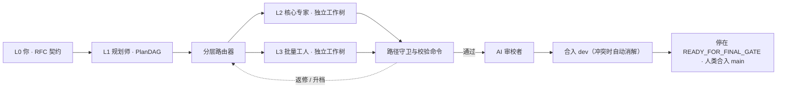
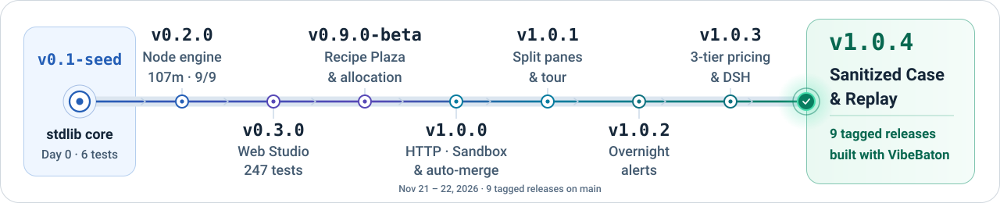
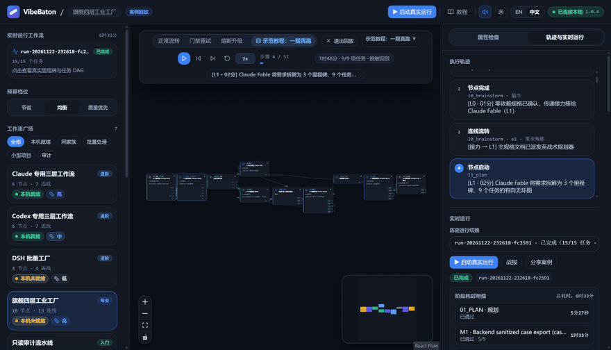
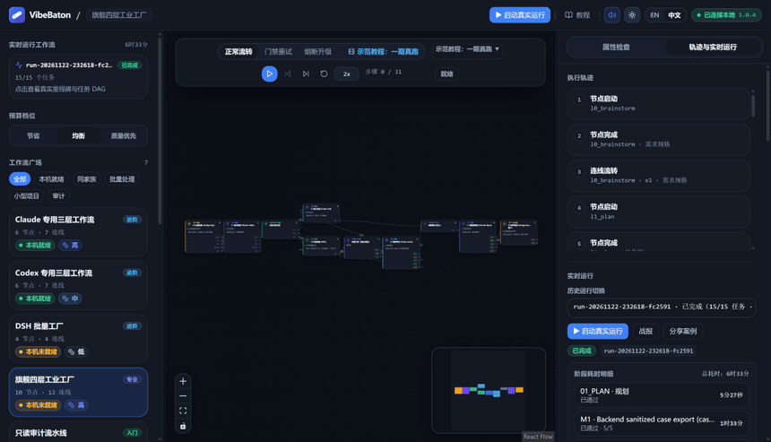
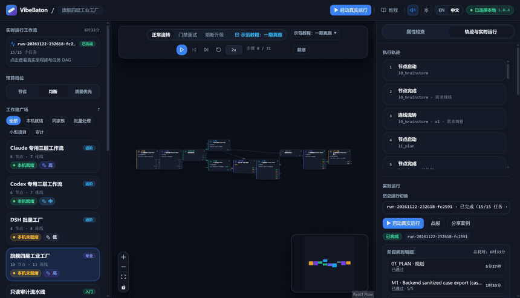
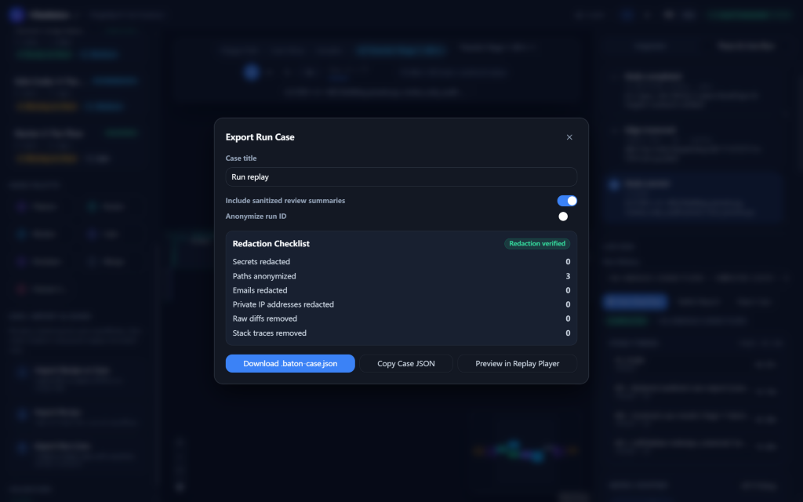

<div align="center">

[English](README.md) | **简体中文**

<picture>
  <source media="(prefers-color-scheme: dark)" srcset="./docs/assets/hero-dark.svg" />
  <source media="(prefers-color-scheme: light)" srcset="./docs/assets/hero-light.svg" />
  
</picture>

**VibeBaton（`baton`）是一个开源的多模型 AI 编程编排器。**
写一页需求契约（RFC），按角色分工调度 Claude、Codex、DSH 或 OpenAI 兼容 HTTP 模型；每项任务在独立 Git 工作树编码，先过真实测试门禁再送 AI 审校，最后由你终审合入。

*从 `v0.2.0` 到 `v1.0.4`，每个版本都是 VibeBaton 在自身仓库上这样接力构建并由人类把关发布的。*

[](https://github.com/KungerChen/VibeBaton/releases)
[](#参与贡献与许可证)
[](LICENSE)
[](pyproject.toml)
[](#快速开始)

[核心能力](#vibebaton-能为你解决什么问题) · [接力原理](#接力流水线如何运转) · [亲眼回放](#自己回放亲眼核验运行过程) · [快速开始](#快速开始)

</div>

## VibeBaton 能为你解决什么问题

VibeBaton 将本机 `127.0.0.1` 的可视化 Studio 与 `baton` 命令行直接连接到你已有的编程订阅与 API，且**Python 运行时零第三方依赖（`dependencies = []`）**。你可以在 Studio 画布中设计并离线模拟工作流、将角色映射保存到 `.baton/baton.toml`，再从 Studio 或终端发起由 RFC 驱动的真实运行（由 `.baton/00_RFC.md` 或 `--plan` 编译生成 `PlanDAG`）。

| 常见多模型开发痛点 | 没有 VibeBaton 时 | 使用 VibeBaton（`baton`）后 |
| :--- | :--- | :--- |
| **分支与文件混乱** | 多个 Agent 在同一目录互相覆盖，或顺手改乱无关文件。 | 每项任务独占 `.baton/worktrees/task-*` 工作树，配合 `allowed_paths` 审计与自动回滚守卫。 |
| **没过测试就“完工”** | Agent 跳过测试，或消耗昂贵审校额度去看编译都报错的代码。 | 开启 `machine_gate_before_ai_review = true` 时，先跑 `verify_cmd` 与 `gate_commands` 机械门禁，再送 AI 审校。 |
| **额度浪费与 `429` 停摆** | 写样板代码烧光旗舰额度，或夜跑半夜撞上限流直接中断。 | 按角色分层路由（Claude/Codex 管规划审校，DSH 批量编码；单轮 HTTP 接口用于规划/审校）+ 分提供方 SQLite `429` 冷却（按整数秒解析 `Retry-After`）与有界升档。 |
| **并行合入冲突** | 人工合并多个并发 Agent 分支时陷入大量代码冲突。 | Auto-Conflict-Resolver 在独立 `_merge_*` 工作树中捕获 squash 合并冲突、消解分歧并重跑门禁。 |
| **耗时与花费成黑盒** | 跨多种 CLI 与 API 运行后，无法定位卡点与真实开支。 | 实时阶段计时（Stage Timing）、CLI JSON/JSONL 与 HTTP 三层美元计价、以及双语战报。 |


<p align="center"><em>图示：Studio 实景监督 Stage 4.8（<code>v1.0.4</code>）自举运行 —— 3/3 里程碑、15/15 任务共 6 小时 33 分，记录 51.48M Token；34/49 次计价调用按模型费率折算为 $22.50（15 次 DSH 调用未上报用量）。全仓库共 1,068 项测试（536 前端 + 532 后端）。</em></p>

## 接力流水线如何运转

把 VibeBaton 想象成一场**自带自动安检门的 4×100 米工程接力赛**：强模型负责拆解 RFC 与划定作用域，并发工人在独立 Git 工作树编码，确定性测试门禁把守每一次交接，最终改动由你签字后才合入 `main`。

- **`L0` · 你 + 宿主架构师：** 编写并确认 RFC 契约，在终审阶段将 `dev` 合并至 `main`。
- **`L1` · 规划师与里程碑审校者：** 将 `.baton/00_RFC.md` 编译为 `PlanDAG`，并审计已完成的里程碑。
- **`L2` · 核心专家与单任务审校者：** 在独立工作树处理关键复杂改动，并执行逐任务审校。
- **`L3` · 批量执行工人：** 在各自隔离工作树中并行编写常规模块与单元测试（例如 DSH）。



## 专家会诊模式（v1.1.0）

当任务是开放式评审而非单一既定规格时，先由 `00_PANEL` 开场：只读专家并行审阅 RFC，Synthesizer 将各路报告合并为一份 master spec，再交给 `01_PLAN` 据此规划。专家全程不修改工作树，所有改动仍要经过下游门禁。

- **运行方式：** `baton run --repo . --rfc .baton/00_RFC.md --mode panel`（REST 侧传 `mode: "panel"`）；各专家转录与 master spec 落在 `.baton/runs/<run_id>/panel/` 下。
- **体验预设：** `specialist_panel` 是配方广场第 8 套预设——三位专家（UX 与文案、视觉与结构、源码与安全）接入 Synthesizer，随后是隔离工人、机械门禁、AI 审校与人类签核。
- **默认档位成本均衡：** 思考与审校使用中高端模型，合成与批量执行使用 `eco` 档模型；将 `[policies].budget_profile` 设为 `"max_quality"` 即可整体向旗舰升档。会诊阵容在 `[panel]` / `[[panel.members]]` 中配置（见 [baton.example.toml](baton.example.toml)）。

## 什么时候该用 VibeBaton？

| 用单个 IDE / CLI 聊天就够了 | 该用 VibeBaton 的时候 |
| :--- | :--- |
| 修复拼写、微调单个文件，或探索不熟悉的源码。 | 推进跨文件新特性、模块重构或测试扩充，且有明确的通过/失败命令。 |
| 5 分钟内就能完成的紧耦合交互式结对微调。 | 希望用旗舰模型管规划与审校，搭配高速并发工人写业务与单测。 |
| 项目尚未建立自动化构建、Lint 或测试命令。 | 需要抗 `429` 限流、隔离并行分支并严控修改边界的后台或通宵长跑。 |

*零密钥预览：直接运行 `baton ui` 启动 Studio，即可离线模拟 `happy_path`、`gate_retry` 与 `escalate`，并浏览 **8 套本机就绪配方预设**。*

## 自举演进时间线（`v0.1-seed` → `v1.0.4`）

从 `v0.2.0` 到 `v1.0.4`，VibeBaton 在自身仓库调度 Claude、Codex 与 DSH 接力构建，并由人类把控方向与终审签核。

<picture>
  <source media="(prefers-color-scheme: dark)" srcset="./docs/assets/timeline-dark.svg" />
  <source media="(prefers-color-scheme: light)" srcset="./docs/assets/timeline-light.svg" />
  
</picture>

<details>
<summary>展开查看全部 9 个版本标签</summary>

| 标签 | 日期 | 交付亮点 |
| :--- | :--- | :--- |
| [`v0.1-seed`](https://github.com/KungerChen/VibeBaton/tree/v0.1-seed) | 2026-11-21 | 零依赖 Python 3.11+ 标准库核心、SQLite WAL 状态机、MCP 服务与 `baton promote-seed --dest <dir>`。 |
| [`v0.2.0`](https://github.com/KungerChen/VibeBaton/tree/v0.2.0) | 2026-11-21 | 用时 107 分钟自举完成节点图引擎（`3/3` 里程碑、`9/9` 任务，测试从 `6` 增至 `63` 项），零运行时依赖。 |
| [`v0.3.0`](https://github.com/KungerChen/VibeBaton/tree/v0.3.0) | 2026-11-21 | 代号 `canvas`：交付标准库 HTTP/SSE 服务与 React 19 Studio（`141` 前端 + `106` 后端 = `247` 项测试）。 |
| [`v0.9.0-beta`](https://github.com/KungerChen/VibeBaton/tree/v0.9.0-beta) | 2026-11-22 | 7 套配方广场预设、智能配给、启动门禁、实时画布联动、双语战报与 `benchmarks/` 对照工具。 |
| [`v1.0.0`](https://github.com/KungerChen/VibeBaton/tree/v1.0.0) | 2026-11-22 | 原生 HTTP 提供方、Token/USD 计费、自动冲突解决器、`sandbox init` 与 [`scripts/install.ps1`](scripts/install.ps1)。 |
| [`v1.0.1`](https://github.com/KungerChen/VibeBaton/tree/v1.0.1) | 2026-11-22 | 可调宽分栏、每秒刷新实时时钟、7 步聚光导览与 Mermaid/SVG 架构指引。 |
| [`v1.0.2`](https://github.com/KungerChen/VibeBaton/tree/v1.0.2) | 2026-11-22 | 通宵运行 Webhook/桌面通知与覆盖 6 种状态的 Studio `AttentionBanner`。 |
| [`v1.0.3`](https://github.com/KungerChen/VibeBaton/tree/v1.0.3) | 2026-11-22 | 三层 API 定价（`custom > official_cache > builtin`）、CLI JSON/JSONL 用量计费与统一 DSH 品牌。 |
| [`v1.0.4`](https://github.com/KungerChen/VibeBaton/tree/v1.0.4) | 2026-11-22 | `baton export-case`、四层脱敏 `.baton-case.json` 运行包与通用案例回放播放器。 |

完整记录见 [CHANGELOG.md](CHANGELOG.md)。双副本自举通过 `baton promote-seed --dest <dir>` 重建独立运行器快照。

</details>

## 自己回放，亲眼核验运行过程

- **配方（`.baton.json` / `#recipe=` 链接）** 仅分享工作流拓扑与角色路由，不含任何运行历史。
- **运行案例（`.baton-case.json`）** 导出可回放的图拓扑、事件轨迹、指标与脱敏审计报告。新克隆仓库内置**一期教程（`1 小时 48 分 · 9/9 任务`）**，零 API Key 即可直接回放（本地 Stage 4.8 SQLite 运行库已加入 `.gitignore`）。

<table><tr>
  <td width="50%"><br /><sub><strong>案例回放（16 FPS 实景动图）：</strong>一期教程实时驱动画布粒子接力、门禁返修与右侧同步轨迹。</sub></td>
  <td width="50%"><br /><sub><strong>运行遥测：</strong>各阶段计时（<code>6h 33m</code>）、Token 明细，以及 <code>34/49</code> 次计价 CLI 调用折算的 <code>$22.50</code>。</sub></td>
</tr><tr>
  <td width="50%"><br /><sub><strong>液态换肤与三栏工作台（16 FPS）：</strong>平滑无闪烁的流体换肤波浪与节点画布交互。</sub></td>
  <td width="50%"><br /><sub><strong>20 节点 DAG 与四层脱敏导出（16 FPS）：</strong>切换查看真实任务依赖图，分享前实时校验隐私脱敏。</sub></td>
</tr></table>

<details>
<summary>四层脱敏与运行案例导出预览</summary>

<p align="center"></p>

使用 `baton export-case --repo . --run-id <id>` 导出（可用 `--no-reviews` 省略审校摘要，或 `--anonymize --out <file>` 匿名化运行 ID 与文件名）。四层模式规则依次清理：**（1）** 密钥与 API Key、**（2）** 本机路径与用户名、**（3）** 邮箱与私有 IPv4 地址、**（4）** 原始 diff 与报错堆栈。仅当 `redaction_report.clean == true` 时 CLI 与 Studio 才放行导出——该审计校验的是既定模式规则，而非保证任意自由文本绝无 PII。
</details>

## 快速开始

1. **安装** — 需要 Python 3.11+（`baton` CLI 与服务端保持 `dependencies = []`）及 Git；构建 Studio 前端需要 `Node 20+`：
   - **Windows**（[`scripts/install.ps1`](scripts/install.ps1)）：先执行 `.\scripts\install.ps1`，再激活 `.\.venv\Scripts\Activate.ps1` · **Linux / macOS**：`python -m pip install -e .`
   - **构建 Studio 前端**：`npm --prefix web ci && npm --prefix web run build`
2. **检查环境并启动 Studio（支持零密钥导览与独立桌面窗）** — 即使尚未配置 API Key，也可立刻运行 `baton ui`（或 `baton ui --app` 弹出无地址栏的独立桌面应用窗口，Windows 用户可直接双击 [`VibeBaton-Studio.bat`](VibeBaton-Studio.bat) 一键启动）体验一期教程回放与离线模拟器：
   ```sh
   baton init --repo . && baton doctor --repo .
   baton ui --app
   ```
   *Windows 桌面快捷方式：* 运行一次 `.\scripts\launch-studio.ps1 -CreateShortcut` 即可在桌面生成带图标的 **VibeBaton Studio** 一键启动快捷方式。
3. **启动通宵运行与导出案例**（在已提交初始 commit 且配好模型提供方的目标 Git 仓库中执行）：
   ```sh
   baton run --repo . --rfc .baton/00_RFC.md --mode overnight --detach
   baton status && baton export-case --repo . --run-id <id>
   ```

> [!WARNING]
> **要在不可信仓库上运行？** 请先执行 `baton sandbox init --repo .` 生成容器脚手架并核对后再构建，详见 [docs/SECURITY.md](docs/SECURITY.md)。

<details>
<summary>容器沙箱（<code>baton sandbox init</code>）</summary>

`baton sandbox init --repo .` 会生成 Docker Compose 与 DevContainer 配置：仅挂载 `/workspace`（不挂载 `~/.ssh`）、丢弃全部 Linux capabilities、启用 `no-new-privileges`、以非 root 用户 `baton` 运行，并在 Compose 中启用只读根文件系统（`tmpfs` 挂载 `/tmp` 与缓存；DevContainer 未启用只读 rootfs）。归档包仅含 Python/CLI 资源，不包含 `web/dist` 与各提供方 CLI——执行 `docker compose -f sandbox/docker-compose.yml run --build --rm vibebaton sh` 前需在容器环境中配置可用提供方。
</details>
<details>
<summary>原生 HTTP 提供方（<code>type = "http"</code>）</summary>

OpenAI 兼容 `/v1/chat/completions` 提供方发起单轮调用，适合规划与文本审校（实际修改仓库文件的编码工人需使用 `claude`、`codex`、`dsh` 等编辑型 CLI）。在 `.baton/baton.toml` 中添加配置并设置 `$env:DEEPSEEK_API_KEY = "YOUR_DEEPSEEK_API_KEY"`：
```toml
[providers.deepseek_http]
type = "http"
base_url = "https://api.deepseek.com/v1"
api_key_env = "DEEPSEEK_API_KEY"
```
注：`baton doctor` 会直接校检 HTTP 端点与密钥配置（并支持 `--role` 实测）。`Retry-After` 按整数秒解析。
</details>
<details>
<summary>三层 API 定价（<code>baton pricing</code>）</summary>

费率按 `custom > official_cache > builtin` 优先级解析，官方价格缓存刷新窗口为 24 小时，同时汇总 CLI JSON/JSONL 与 HTTP 调用成本。可通过 `baton pricing sync --repo .` 与 `baton pricing show --repo .` 同步和查看。
</details>
<details>
<summary>通宵 Webhook 与桌面提醒（<code>baton notify-test</code>）</summary>

在 `.baton/baton.toml` 中配置 `[notifications]`，支持飞书、企业微信、钉钉、Slack、Discord、通用 Webhook、Windows 桌面通知与终端响铃（Studio 顶部 `AttentionBanner` 覆盖 6 种提醒状态）。使用 `baton notify-test --repo .` 测试渠道投递（参见 [baton.example.toml](baton.example.toml)）。
</details>
<details>
<summary>Antigravity MCP 服务（<code>baton mcp</code>）</summary>

通过 `baton mcp --repo <path>` 或 `<repo>/src` 暴露全部 9 个 MCP 控制面工具（`baton_health`、`baton_start`、`baton_status`、`baton_logs`、`baton_resolve`、`baton_control`、`baton_final_package`、`baton_list_presets`、`baton_validate_graph`），配置见 [agy_integration/mcp_config.snippet.json](agy_integration/mcp_config.snippet.json) · [agy_integration/SKILL.md](agy_integration/SKILL.md)。
</details>

## 坦诚的使用与安全边界

- **自备密钥与账单：** 纯本地运行、零加价代理，费用由模型提供方按你的账号直接结算。`$22.50` / `51.48M` 指标来自单次 Stage 4.8 运行（`run-20261122-232618-fc2591`）中 `34/49` 次计价 CLI 调用；[`benchmarks/`](benchmarks/) 默认以 `--mock` 运行，传入 `--live` 可做真实模型对比。
- **守卫 ≠ 内核沙箱：** 路径白名单守卫在单轮 CLI 结束后通过 Git 工作树执行审计与回滚。宿主机流水线仅用于可信仓库；运行不可信仓库请使用 `baton sandbox init`（见[安全模型](docs/SECURITY.md)）。
- **测试明确最出彩：** 最适合有清晰构建、Lint 或测试命令支撑的跨文件改造；单文件小修用单聊更快。
- **人类始终掌舵：** 里程碑产物汇入 `dev`（停在 `READY_FOR_FINAL_GATE`），在人类操作者或 L0 架构师审阅合入前绝不触碰 `main`（`PLAN_AMENDMENT` 也会暂停进入 `WAITING_HUMAN`；`[policies].require_human_approval_at` 记录项目门禁策略）。

## 版本与文档

`v1.0.0` 带来了原生 HTTP 提供方、自动冲突解决器、容器沙箱脚手架与 Windows 安装器；随后的 `v1.0.1`–`v1.0.4` 陆续交付了可调宽分栏、通宵提醒、三层定价与脱敏案例回放。  
[GitHub Releases](https://github.com/KungerChen/VibeBaton/releases) · [更新日志](CHANGELOG.md) · [v1.0 发布说明](docs/RELEASE_NOTES_v1.0.md) · [入门教程](docs/TUTORIAL.md) · [路线图](docs/ROADMAP.md) · [安全模型](docs/SECURITY.md)

## 参与贡献与许可证

```sh
python -m unittest discover -s tests -v
npm --prefix web ci && npm --prefix web test
```

当宿主机缺少 Docker、Windows 符号链接权限或未跟踪的本地 SQLite 运行库时，Python 测试会按条件跳过对应检查。本项目基于 [MIT 许可证](LICENSE)开源。
