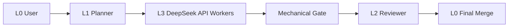

# VibeBaton 新手保姆级图文教程（从零到首次跑通通宵多模型协作）

> 不懂多 Agent、Worktree、DAG 也没关系！用 **接力赛工厂** 的方式看懂 VibeBaton，5 分钟就能跑通你的第一个自动化开发工作流。

---

## 一、一分钟看懂 VibeBaton（建筑施工接力赛比喻）

平时只用 1 个昂贵旗舰 AI 从头写到大项目，经常遇到两个痛点：**贵**（写 20 个简单文件也用顶级模型），**易翻车**（上下文爆了、改错别的文件、没有跑测试就宣称完成）。

VibeBaton 把开发拆成一场 **四层接力赛**：

| 层级 | 通俗角色 | 代表模型 / 工具 | 负责做什么 |
| :--- | :--- | :--- | :--- |
| **L0 总控大脑 + 你** | 甲方老板与总设计师 | **你 + Antigravity** | 开工前对齐《需求规格文档（RFC）》与验收测试命令；全部完成后审阅战报并签字合入主分支。 |
| **L1 规划师 & 里程碑审校** | 架构师 & 验收官 | Claude / Codex 等推理模型 | 把需求拆成有序的里程碑和子任务（DAG）；每个里程碑合并前亲自把关架构与测试通过情况。 |
| **L2 核心攻坚 & 微观审校** | 技术专家 & 代码评审员 | Codex / Claude 等高阶模型 | 攻克核心架构文件；常规代码改错或卡死时接手救场（熔断升档）；对每个任务做逐项 Review。 |
| **L3 并发批量工人** | 高性价比熟练工团队 | **DeepSeek API** 等快而省模型 | 在彼此隔离的 Git Worktree 目录中并行开发常规模块与单元测试。 |
| **机械门禁 & 路径白名单** | 自动安检门（0 成本） | `unittest` / `tsc` / `lint` / Git | AI 刚交卷就先免费跑单测和路径检查——越界改动直接回滚、单测不过原地返修，绝不浪费上层高阶额度！ |

> 下图与工作台右上角 **教程（Guide）→「详细教程」（Tutorial）** 标签页中的四层接力流程图一致；你也可以在「快速开始」弹窗点击 **开始 1 分钟交互式导览（Start 1-Minute Interactive Tour）** 跟着高亮上手。



---

## 二、怎么启动界面（Windows PowerShell）

打开 PowerShell，在你的仓库目录运行以下三步即可看到可视化画布（纯 Python 标准库启动，无需额外安装服务）：

```powershell
# 1. 进入 VibeBaton 目录并构建前端（首次使用）
cd D:\Projects\VibeBaton\web
npm install
npm run build

# 2. 启动本地可视化工作台（自动打开 http://127.0.0.1:7860/）
cd D:\Projects\VibeBaton
$env:PYTHONPATH = "D:\Projects\VibeBaton\src"
python -m vibebaton ui --repo D:\Projects\YourProject
```

> 提示：浏览器打开后右上角可随时切换 **EN | 中文** 与浅色/深色主题。点右上角 **教程（Guide）** 按钮，选择第 3 个 **「详细教程」** 标签页也能在页面里直接看本指南摘要！

---

## 三、新手五步跑通首次真实任务

### 第 1 步：在左侧选预算档位和「本机就绪」配方
1. **预算档位（Budget Profile）**：新手建议先点 **节省（Eco）**，日常开发推荐 **均衡（Balanced）**。
2. **工作流广场（Recipe Plaza）**：在左侧筛选 **「本机就绪」**，带有绿色圆点标牌的说明你电脑上的 CLI / API Key 已配置妥当：
   - 预算极简、只有 1 个 Key：选 **`极简入门双层流（Starter 2-Tier Flow）`** 或 **`DeepSeek API 批量工厂`**。
   - 混合多个订阅与 API：选 **`个人开发三层流`** 或 **`旗舰四层工业工厂`**。

### 第 2 步：点击右下/右侧「▶ 启动真实运行」完成三段式发车向导
切换到右侧面板的 **「轨迹与实时运行」** 标签页，点击 **「▶ 启动真实运行」**：
1. **向导第 1 步 —— 运行前检查与凭据**：
   - 可以直接在页面填入并保存 `DeepSeek API Key`、`OpenAI API Key`、`Anthropic API Key` 等本地密钥（仅写入你本机用户目录，绝不提交进 Git 仓库）。
   - 如果你还没安装 Claude / Codex CLI，向导会给出官方复制命令和本机已就绪的替代方案。
   - 画布节点右下角的 **5 秒诊断（5s Doctor）** 按钮可以现场实测每个模型能不能调通以及延迟多少毫秒。
2. **向导第 2 步 —— 头脑风暴与 RFC 体检**：
   - 用四栏小表单填写：**目标（Goal）**、**约束（Constraints）**、**自动化验证命令（如 `python -m unittest` 或 `npm test`）**、**非目标（Non-goals）**。
   - 点击 **生成 RFC** 后，系统会自动进行机械体检并给出 **就绪评分（0~100）**：只有包含可自动化验收命令和清晰边界时才会标绿「可通宵运行」，有效避免通宵空跑。
3. **向导第 3 步 —— 核对分工与安全护栏，正式发车**：
   - 确认运行模式：**通宵无人值守（Overnight）** 或 **交互式（Interactive）**。
   - 发车前会在页面下方清晰展示 **「模型分工与安全护栏」** 卡片：当前预算档位、各角色对应模型与最大并发数，以及 429 冷却保护、路径白名单和人类终审三道安全防线。

### 第 3 步：点击左侧「实时运行工作流」，画布实时同步进度
- 当任务启动或存在运行记录时，左侧最上方会出现 **「实时运行工作流（Live Run Workflow）」** 卡片（显示当前 `run_id`、状态、完成任务数与已耗时）。
- **点击该卡片**，中间画布会立刻切换成本次真实运行的实时 DAG 图：**规划（01_PLAN） → 每个里程碑下的并行任务 → 里程碑审校 → L0 终审合入**，并在连线和节点上用青色流光粒子和翠绿实线展示最新进度！
- 想切回蓝图模板时，点击左侧「预置工作流」里的任意配方即可切换回来。

### 第 4 步：右侧实时看板：阶段耗时、模型耗时与单任务下钻
在右侧 **「轨迹与实时运行」** 面板中，你可以随时掌握全局成本与质量：
- **历史运行切换（Run History）**：下拉可随时切回 Stage 1 / Stage 2 / Stage 3 等历史真跑记录对比数据。
- **阶段耗时明细（Stage Timing）**：直观看到规划阶段（`01_PLAN`）以及 `M1 / M2 / M3...` 每个里程碑各自跑了多久、多少任务通过。
- **模型运行统计（Model Runtime）**：统计 DeepSeek API、Codex、Claude 等每个模型被调用了几次、累计耗时、平均单次耗时以及占比进度条。
- **点击任务行看详情**：点击任务表里的任意一行，即可原地展开该任务的**分配模型、实际耗时、自愈/退修/升级次数、允许修改文件路径白名单、机械门禁报错详情与专属审计事件流**。

### 第 5 步：看中英文战报与 L0 终审签字
- 点击 **「战报（Battle Report）」** 可直接查看结构化 Markdown 总结（切换到中文界面即生成纯中文战报，并包含阶段与模型耗时统计表；点工具栏可复制 Markdown 发 Build-in-Public）。
- 全部里程碑默认只合并到 `dev` 分支，不会自动碰你的 `main` 主干；确认所有测试与战报无误后，点 **批准（Approve）** 或在命令行执行最终合入与验收即可！

---

## 四、新手常见问题（FAQ）

1. **为什么启动运行后，左侧和中间画布没有自动显示真实任务？**
   - 左侧下方的「预置工作流」是通用架构蓝图；只要本机有运行记录，**左侧面板最顶部** 会亮起 **「实时运行工作流」** 卡片——点一下它就能切到实时里程碑与任务画布。
2. **如何在不写代码的情况下低成本体验？**
   - 直接打开画布上方的 **「一期真跑 60×」** 按钮即可零成本回放 VibeBaton 真实自举全过程，也可以用 **`极简入门双层流`** + **节省（Eco）** 跑你自己的小任务。
3. **运行到半夜某家模型报 `429 Rate Limit` 或超时卡住怎么办？**
   - 引擎会自动把限流的那一家模型送入 **指数冷却池（Cooldown）**，不影响其他模型继续干活；如果某个 L3 任务多次没过门禁，会自动触发 **智能升档（Step-Up）** 转交给更强推理档位或 L2 核心模型处理。
4. **AI 乱改了不该改的配置文件怎么办？**
   - 每个任务在规划阶段都会绑定 `allowed_files` 白名单并在独立 Git Worktree 沙盒里运行。越界改动会在物理层面被直接拦截回滚，不留脏文件。
   > 下图与 **教程（Guide）→「详细教程」（Tutorial）** 标签页中的工作树保护图一致；在「快速开始」弹窗点击 **开始 1 分钟交互式导览（Start 1-Minute Interactive Tour）** 也能跟着高亮查看这些护栏。

   ```mermaid
   flowchart LR
     subgraph WT["并行隔离工作树 .baton/worktrees/task-*"]
       T1[".baton/worktrees/task-101"]
       T2[".baton/worktrees/task-102"]
       T3[".baton/worktrees/task-103"]
     end
     T1 --> WR["Whitelist Revert"]
     T2 --> WR
     T3 --> WR
     WR -->|白名单内改动| Gate["Mechanical Gate"]
     Gate --> Main["main"]
     WR -.->|越界写入被拦截| Blocked["Blocked"]
   ```

5. **还有哪些更详细的参考文档？**
   - 安全边界与权限说明：[docs/SECURITY.md](SECURITY.md)
   - Stage 3 架构设计稿：[docs/RFC_STAGE3_DRAFT.md](RFC_STAGE3_DRAFT.md)
   - 版本演进路线图：[docs/ROADMAP.md](ROADMAP.md)
