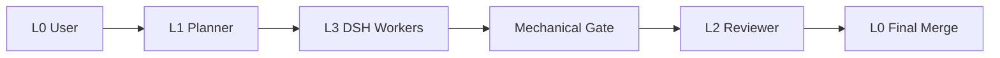

# VibeBaton 新手保姆级图文教程（从零到首次跑通通宵多模型协作）

> 不懂多 Agent、Worktree、DAG 也没关系！用 **接力赛工厂** 的方式看懂 VibeBaton，5 分钟就能跑通你的第一个自动化开发工作流。

---

## 一、一分钟看懂 VibeBaton（建筑施工接力赛比喻）

平时只用 1 个昂贵旗舰 AI 从头写到大项目，经常遇到两个痛点：**贵**（写 20 个简单文件也用顶级模型），**易翻车**（上下文爆了、改错别的文件、没有跑测试就宣称完成）。

VibeBaton 把开发拆成一场 **四层接力赛**：

| 层级 | 通俗角色 | 代表模型 / 工具 | 负责做什么 |
| :--- | :--- | :--- | :--- |
| **L0 总控大脑 + 你** | 甲方老板与总设计师 | **你 + Antigravity** | 开工前对齐《需求规格文档（RFC）》与验收测试命令；全部完成后审阅战报并签字合入主分支。 |
| **L1 规划师 & 里程碑审校** | 架构师 & 验收官 | Claude / Codex 等推理模型 | 把需求拆成有序的里程碑和子任务（DAG）；每个里程碑合并前亲自把关架构与测试通过情况。 |
| **L2 核心攻坚 & 微观审校** | 技术专家 & 代码评审员 | Codex / Claude 等高阶模型 | 攻克核心架构文件；常规代码改错或卡死时接手救场（熔断升档）；对每个任务做逐项 Review。 |
| **L3 并发批量工人** | 高性价比熟练工团队 | **DSH** 等快而省 CLI | 在彼此隔离的 Git Worktree 目录中并行开发常规模块与单元测试。 |
| **机械门禁 & 路径白名单** | 自动安检门（0 成本） | `unittest` / `tsc` / `lint` / Git | AI 刚交卷就先免费跑单测和路径检查——越界改动直接回滚、单测不过原地返修，绝不浪费上层高阶额度！ |

> 下图与工作台右上角 **教程（Guide）→「详细教程」（Tutorial）** 标签页中的四层接力流程图一致；你也可以在「快速开始」弹窗点击 **开始 1 分钟交互式导览（Start 1-Minute Interactive Tour）** 跟着高亮上手。



---

## 二、怎么启动界面（Windows PowerShell）

打开 PowerShell，在你的仓库目录运行以下三步即可看到可视化画布（纯 Python 标准库启动，无需额外安装服务）：

```powershell
# 1. 进入 VibeBaton 目录并构建前端（首次使用）
cd D:\Projects\VibeBaton\web
npm install
npm run build

# 2. 启动本地可视化工作台（自动打开 http://127.0.0.1:7860/）
cd D:\Projects\VibeBaton
$env:PYTHONPATH = "D:\Projects\VibeBaton\src"
python -m vibebaton ui --repo D:\Projects\YourProject
```

> 提示：浏览器打开后右上角可随时切换 **EN | 中文** 与浅色/深色主题。点右上角 **教程（Guide）** 按钮，选择第 3 个 **「详细教程」** 标签页也能在页面里直接看本指南摘要！

---

## 三、新手五步跑通首次真实任务

### 第 1 步：在左侧选预算档位和「本机就绪」配方
1. **预算档位（Budget Profile）**：新手建议先点 **节省（Eco）**，日常开发推荐 **均衡（Balanced）**。
2. **工作流广场（Recipe Plaza）**：在左侧筛选 **「本机就绪」**，带有绿色圆点标牌的说明你电脑上的 CLI / API Key 已配置妥当：
   - 预算极简、只有 1 个 Key：选 **`极简入门双层流（Starter 2-Tier Flow）`** 或 **`DSH 批量工厂`**。
   - 混合多个订阅与 API：选 **`个人开发三层流`** 或 **`旗舰四层工业工厂`**。

### 第 2 步：点击右下/右侧「▶ 启动真实运行」完成三段式发车向导
切换到右侧面板的 **「轨迹与实时运行」** 标签页，点击 **「▶ 启动真实运行」**：
1. **向导第 1 步 —— 运行前检查与凭据**：
   - 可以直接在页面填入并保存 `DSH API Key`、`OpenAI API Key`、`Anthropic API Key` 等本地密钥（仅写入你本机用户目录，绝不提交进 Git 仓库）。
   - 如果你还没安装 Claude / Codex CLI，向导会给出官方复制命令和本机已就绪的替代方案。
   - 画布节点右下角的 **5 秒诊断（5s Doctor）** 按钮可以现场实测每个模型能不能调通以及延迟多少毫秒。
2. **向导第 2 步 —— 头脑风暴与 RFC 体检**：
   - 用四栏小表单填写：**目标（Goal）**、**约束（Constraints）**、**自动化验证命令（如 `python -m unittest` 或 `npm test`）**、**非目标（Non-goals）**。
   - 点击 **生成 RFC** 后，系统会自动进行机械体检并给出 **就绪评分（0~100）**：只有包含可自动化验收命令和清晰边界时才会标绿「可通宵运行」，有效避免通宵空跑。
3. **向导第 3 步 —— 核对分工与安全护栏，正式发车**：
   - 确认运行模式：**通宵无人值守（Overnight）** 或 **交互式（Interactive）**。
   - 发车前会在页面下方清晰展示 **「模型分工与安全护栏」** 卡片：当前预算档位、各角色对应模型与最大并发数，以及 429 冷却保护、路径白名单和人类终审三道安全防线。

### 第 3 步：点击左侧「实时运行工作流」，画布实时同步进度
- 当任务启动或存在运行记录时，左侧最上方会出现 **「实时运行工作流（Live Run Workflow）」** 卡片（显示当前 `run_id`、状态、完成任务数与已耗时）。
- **点击该卡片**，中间画布会立刻切换成本次真实运行的实时 DAG 图：**规划（01_PLAN） → 每个里程碑下的并行任务 → 里程碑审校 → L0 终审合入**，并在连线和节点上用青色流光粒子和翠绿实线展示最新进度！
- 想切回蓝图模板时，点击左侧「预置工作流」里的任意配方即可切换回来。

### 第 4 步：右侧实时看板：阶段耗时、模型耗时与单任务下钻
在右侧 **「轨迹与实时运行」** 面板中，你可以随时掌握全局成本与质量：
- **历史运行切换（Run History）**：下拉可随时切回 Stage 1 / Stage 2 / Stage 3 等历史真跑记录对比数据。
- **阶段耗时明细（Stage Timing）**：直观看到规划阶段（`01_PLAN`）以及 `M1 / M2 / M3...` 每个里程碑各自跑了多久、多少任务通过。
- **模型运行统计（Model Runtime）**：统计 DSH、Codex、Claude 等每个模型被调用了几次、累计耗时、平均单次耗时以及占比进度条。
- **点击任务行看详情**：点击任务表里的任意一行，即可原地展开该任务的**分配模型、实际耗时、自愈/退修/升级次数、允许修改文件路径白名单、机械门禁报错详情与专属审计事件流**。

### 第 5 步：看中英文战报与 L0 终审签字
- 点击 **「战报（Battle Report）」** 可直接查看结构化 Markdown 总结（切换到中文界面即生成纯中文战报，并包含阶段与模型耗时统计表；点工具栏可复制 Markdown 发 Build-in-Public）。
- 全部里程碑默认只合并到 `dev` 分支，不会自动碰你的 `main` 主干；确认所有测试与战报无误后，点 **批准（Approve）** 或在命令行执行最终合入与验收即可！

---

## 四、引导模式（Guided Mode）：四步完成第一次真实任务

页头右侧的 **引导模式 / 专业模式** 开关可以随时切换，选择会记在浏览器的 `localStorage` 里（默认是专业模式）。上一章的专业流程随时可用；专业模式保留全部配方、节点、路由字段与轨迹，引导模式则每次只把当前需要的一个决策放到你面前。两者共用同一套引擎、REST API 与安全门禁，来回切换不会丢失已选的工作区与团队。

### 第 1 步：工作区与工具箱

1. **选择项目文件夹**：在 **「当前项目文件夹」** 输入框填入本机目录，点 **「选择项目文件夹」** 确认；页面会显示该目录以及是否已开启版本记录。
2. **开启版本记录**：目录还不是 Git 仓库时会出现 **「开启版本记录」** 按钮，点它执行 `git init`。后续每一步改动都可审阅、可撤销，第 4 步的回滚也依赖它。
3. **扫描 AI 编程工具**：点 **「扫描 AI 编程工具」**（进入本步时也会自动扫描一次），Studio 会读取通用 CLI 注册表（Universal CLI Registry）里的 8 个驱动，逐个显示 **已就绪 / 未安装 / 需登录**，并给出推荐阵容。`dsh` 驱动在界面与文档中统一展示为 **DSH**。
4. **按状态处理驱动**：
   - **未安装**：行内会显示该驱动的安装命令和一个复选框。**只有勾选这个复选框，「安装」按钮才会启用**；安装只执行注册表内的命令（接口同样要求 `confirmed: true`），不会自动替你执行其他命令。
   - **需登录**：点 **「登录」** 发起该 CLI 官方的登录流程，完成后重新扫描即可看到 **已就绪**。
5. 推荐阵容可用时，点 **「使用这支团队」** 进入下一步。

### 第 2 步：头脑风暴与蓝图卡

1. 选一个内置场景起步，或在输入框写清你的想法、限制条件，以及如何判断它已经完成，点 **「发送」**。可以连续多轮对话，直到方案足够具体。
2. 对话旁会生成一张 **蓝图卡（Blueprint Card）**：概要、交付物、将会改动的项目区域、验证方式与就绪度。需要看全文时展开 **「查看完整 RFC」**。
3. 确认无误后点 **「确认蓝图并开始施工」**：系统会写出 `.baton/00_RFC.md`、运行就绪度检查，再按推荐阵容启动本次运行。

### 第 3 步：施工地图、任务详情与决策卡

- **任务地图**会实时跟随规划（`01_PLAN`）→ 里程碑任务 → 审校 → 终审的进度，与专业模式显示的是同一份真实运行。
- 点击地图上的任意任务，右侧 **任务详情** 抽屉会用通俗的话说明这一刻 **发生了什么**，并列出所用模型、耗时、成本、测试结果、改动的文件与评审结论。
- 人工节点需要你拍板时会弹出 **决策卡**：读清问题与每个选项的说明，选择后可填写给团队的备注，再点 **「提交决定」**。决策提交成功后才会关闭；如果运行仍在等待同一个决定，刷新后决策卡会再次出现。

### 第 4 步：验收、签收与回滚

全部任务完成、运行进入待终审后，会出现 **最终验收** 面板，先展示验证结果与改动的文件，并提供 **「打开战报」** 复核完整证据，然后由你选择：

- **「批准并合并」**：把本次成果合入主分支。运行开始时已在主分支创建轻量标签 **`baton-backup/<run_id>`**，批准前还会幂等复核这个备份，因此随时都有可回退的锚点。
- **「要求修改」**：展开输入框填写修订说明，必须填写才能提交；运行会带着这些意见暂停，而不是被静默结束。
- **「回滚」**：需要连点两次确认。它只撤销仍在主分支最新的本次获批合并，把主分支恢复到批准前记录的基准提交，不会连带丢弃运行期间落在主分支上的其他提交；`baton-backup/<run_id>` 标签保持不变，需要回到运行起点的快照时可执行 `git reset --hard baton-backup/<run_id>`（该命令会丢弃标签之后的提交，执行前请确认没有别的工作依赖它们）。

这三个动作对应的接口是 `POST /api/runs/<run_id>/finalize`，`action` 取 `approve`、`revise` 或 `rollback`。

### 随时打开术语表（Glossary）

- 点页头右侧的 **「术语表」** 打开抽屉：输入关键词即可过滤词条，点开后可切换 **通俗解释** 与 **技术细节**，并通过 **相关术语** 跳到相邻概念。
- 正文里带下划线的行内术语也能直接点开同一个词条；`EN` 与 `中文` 界面都可用。
- 术语表内置 220+ 条 `EN | 中文` 术语，覆盖 AI、工程、报错、Git、Web/HTTP 与 VibeBaton 概念，引导模式与专业模式共用。

---

## 五、快速开始：跟 Stage 1 示例学案例回放

- 点右上角 **教程（Guide）**，或在首次启动时打开 **快速开始（Quick Start）** 弹窗；第 1 步用极简 DSH 双层流演示正常流转，先熟悉画布与接力动画。
- 第 2 步 **「观看一期自举 60× 真实回放」** 就是 Stage 1 的交互式案例回放教程：点击后加载官方 `.baton-case.json`，顶部中央播放条显示 **`示范教程：一期真跑`**，可播放、暂停与单步前进。
- 想回放同事分享的案例，点播放条案例切换器里的 **「导入其他案例」**，或走下一节的 **「导入配方或案例」** 入口；载入后按钮会变成 **`▶ 开始回放：<案例名>`**。
- 如果只想复用工作流而不分享历史运行，应导出配方 `.baton.json`；配方与运行案例各自包含什么、如何导出与导入，见下一节。

---

## 六、配方分享与案例回放（.baton.json vs .baton-case.json）

> 一句话区分：**配方（Recipe）分享「怎么做」的流程，运行案例（Run Case）分享「做出来是什么样」的脱敏回放。** 两者都是普通 JSON 文件，可以提交进 Git 仓库或发给同事；运行案例已脱敏，配方则需在分享前自行检查内容（见下）。

### 1. 配方 `.baton.json`：只有工作流图和模型路由

- **包含什么**：工作流图（节点类型、连线、布局、节点标题）与模型路由（每个角色使用的 `provider` / `model`、预算档位、并发数、循环上限等配置）。它只描述「这条流水线长什么样、每一步交给谁」；导出时会把当前画布上的图**原样序列化**，所以你在节点标题、配置等自定义字段里手填的内容也会一并带上。
- **不包含什么**：不会打包运行代码、diff、运行日志、账号信息，也不会主动读取本机 API Key 或环境变量。但配方没有自动脱敏步骤：如果节点标题、配置等自定义字段里贴过本机绝对路径、密钥等私密内容，它们会原样出现在 `.baton.json` 和 `#recipe=` 分享链接里。
- **怎么导出**：左侧 **「配方与案例分享（Save, Import & Share）」** → **「导出配方」**。先展开 **「预览 JSON」** 检查节点标题、配置等自定义内容，确认没有本机路径、密钥等私密内容后，再 **下载 `.baton.json`**、**复制 JSON** 或 **复制 `#recipe=` 分享链接**（链接与文件是同一份工作流图的序列化结果）。
- **怎么导入**：左侧 **「导入配方或案例」** → 选择文件 / 把 `.baton.json` 拖进弹窗 / 粘贴 JSON 或 `#recipe=` 链接 → 核对预览里的节点与连线 → 点 **「将配方应用到画布」**。

### 2. 运行案例 `.baton-case.json`：一场可回放的脱敏「录像」

运行案例在配方之上多记录了「这次真跑发生了什么」，主要包含四块：

| 字段 | 内容 |
| :--- | :--- |
| `graph` | 根据真实运行重建、且已脱敏的工作流图（规划 → 各里程碑任务 → 审校 → L0 终审），保留节点分工与模型路由。 |
| `trace` | 按 `seq` 排序的轨迹事件（`node_started` / `node_completed` / `edge_traversed` / `graph_completed` 等），回放时驱动节点高亮、连线粒子和右侧事件流。 |
| `meta` | 运行状态、总耗时、里程碑/任务通过数、门禁拦截数、白名单拦截数、升档次数、参与模型、阶段耗时与账单摘要。 |
| `redaction_report` | 四层脱敏的逐项计数，以及 `clean: true` 表示序列化后的整包已通过残留密钥审计。 |

### 3. 四层脱敏防火墙（每层一句话）

1. **密钥层（Secrets）**：把常见 API Key、CLI token、`Bearer` 凭据、Webhook 地址里的密钥片段，以及本机凭据文件中的已知密钥，统一替换成 `[REDACTED]`。
2. **路径层（Paths & Usernames）**：仓库根目录替换为 `<repo>`，用户主目录（如 `C:\Users\<name>`、`/home/<name>`）替换为 `<home>`，其余绝对路径替换为 `<path>/文件名`，同时抹掉用户名。
3. **身份层（Emails & IPs）**：邮箱替换为 `[REDACTED_EMAIL]`，内网 IPv4 地址替换为 `[REDACTED_IP]`，并避开 `1.0.4` 这类版本号与时间戳。
4. **代码与堆栈层（Code & Stack）**：整段移除原始 Git diff 与 Python / JavaScript 堆栈，留下 `[diff stripped]` / `[stack trace stripped]` 标记；可选不导出审校摘要，或把 `run_id` 匿名化成稳定的 `case-<短哈希>`。

> CLI 仅在 `redaction_report.clean == true` 时写出案例。Studio 在脱敏检查失败时显示提示，并禁用下载、复制案例 JSON 和播放器预览。

### 4. 怎么导出一个运行案例

**命令行（推荐，适合归档和放进 CI）**：

```powershell
# 在仓库根目录执行；--repo 指向 VibeBaton 管理的项目，<id> 是运行 ID
baton export-case --repo . --run-id <id>

# 常用可选项
baton export-case --repo . --run-id <id> --title "复现 429 冷却" --out my-case.baton-case.json
baton export-case --repo . --run-id <id> --no-reviews --anonymize
```

命令会先打印 `secrets_redacted` / `paths_anonymized` / `emails_redacted` / `ips_redacted` / `raw_diff_stripped` / `raw_stack_stripped` / `clean` 的摘要，再写出 `<id>.baton-case.json`。若脱敏审计不通过，命令会以非零码退出，不会生成文件。

**界面**：左侧 **「配方与案例分享」** 里的 **「导出运行案例」** 卡片（本地有运行记录或已选中运行时出现），或右侧 **「轨迹与实时运行」** 面板里的 **「分享案例（Share Case）」** 按钮。弹窗里可以修改案例标题、选择是否包含已脱敏审校摘要 / 匿名化运行 ID，核对 **脱敏检查清单** 后再 **下载 `.baton-case.json`**、**复制案例 JSON** 或 **在播放器中预览**。

### 5. 怎么导入、拖拽或粘贴案例

1. 打开左侧 **「导入配方或案例」**。
2. 选择任意一种方式：
   - 点击上传区选择 `.baton-case.json`（也支持 `.baton.json` 与普通 `.json`）；
   - 直接把文件拖到上传区；
   - 把案例 JSON 粘贴进文本框（配方链接 `#recipe=` 也走同一个入口）。
3. 弹窗会自动识别 **配方** 还是 **运行案例**，并分别展示预览卡（案例只是脱敏回放，不会执行任何命令）：
   - **配方预览**：结构有效时显示名称、节点数、连线数与 **校验通过** 徽章；结构无效时显示 **校验失败** 和错误信息。底部按钮为 **「将配方应用到画布」**（结构无效时禁用）。
   - **运行案例预览**：结构有效时除名称、节点数、连线数外，还会显示耗时与通过任务数；除 **校验通过** 徽章外，另有脱敏状态徽章——`redaction_report.clean` 为 `true` 时显示 **脱敏检查通过**，否则显示 **请检查脱敏结果**。结构有效但脱敏未通过的案例会同时出现 **校验通过** 和 **请检查脱敏结果**，请先确认脱敏结果再决定是否载入。
4. 点 **「加载并回放案例」** 确认导入后，画布会切换到该案例的工作流图并自动开始回放。

### 6. 顶部中央播放器：从示范教程切到你的案例

- 默认情况下，顶部中央播放条显示 **`示范教程：一期真跑`**，提示语是「观看一期运行回放，或导入 `.baton-case.json` 文件回放其他运行。」
- 载入任意社区或导出的案例后，同一个按钮会变成 **`▶ 开始回放：<案例名>`**。在导入弹窗确认 **「加载并回放案例」** 后会自动开始回放，无需再点它；播放／暂停请用播放条上的控制按钮。
- 旁边的案例切换器可以在已导入的案例间切换，也可以 **「导入其他案例」** 或 **「返回一期示范教程」**。
- 回放时画布会同步节点状态与连线粒子，播放条右侧显示「耗时 · 通过/总数 项任务 · 脱敏回放」摘要；空格键播放/暂停，`→` 单步前进。

> 安全提醒：`.baton-case.json` 已做四层脱敏，但分享前仍建议打开 `redaction_report` 看一眼计数，并确认 `clean` 为 `true`。配方文件没有自动脱敏，分享前请用 **「预览 JSON」** 检查节点标题、配置等自定义内容里是否含本机路径、密钥或私密信息。

---

## 七、Specialist Panel mode（专家会诊模式）

`--mode panel` 会在正式规划前增加 **`00_PANEL`** 阶段：多位只读专家并发审查 RFC，Synthesizer 把各方意见合并成一份 `master_spec.md`，再连同原 RFC 一起交给 `01_PLAN`。专家只读、不修改仓库，适合架构评审、视觉与文案把关、安全与兼容性审查等多视角任务。

### 1. 配置专家阵容

在 `baton.toml` 中加入 `[panel]` 表与若干 `[[panel.members]]`（以下摘自仓库根目录的 `baton.example.toml`）：

```toml
[panel]
enabled = true
max_concurrency = 3
synthesizer_provider = "claude_sub"
synthesizer_model = "sonnet@high"

[[panel.members]]
id = "ux_copy"
perspective = "UX & Copy"
provider = "claude_sub"
model = "opus@high"

[[panel.members]]
id = "visual_structure"
perspective = "Visual & Structure"
provider = "gemini_http"
model = "gemini-4-neon-high"

[[panel.members]]
id = "source_safety"
perspective = "Source & Safety"
provider = "codex_sub"
model = "gpt-6.2-sol@max"
fallback = [{ provider = "claude_sub", model = "opus@high" }]
```

> 未配置 `[panel]` 时，`--mode panel` 会根据当前 `[providers]` 自动推导三位专家（UX / Visual / Safety）和合成器；`max_concurrency` 控制同时审查的专家数，单个专家失败会被跳过，全部失败或合成失败才会让本次运行失败。

### 2. 启动会诊运行

核心参数是 `baton run --mode panel`；在仓库根目录可配合 `--repo` 与 `--rfc` 使用：

```powershell
baton run --repo . --rfc 00_RFC.md --mode panel
```

在 Studio 的 **StartRunModal** 启动向导中，点击 **「▶ 启动真实运行」** → 第 3 步 **运行模式（Run Mode）** 选择 **「专家会诊 + 执行」（Specialist Panel + Execute）**，即可走同一套 `--mode panel` 流程。

### 3. 产物与如何进入 `01_PLAN`

每次会诊的产物都在本次运行目录下：

```text
.baton/runs/<run_id>/panel/
├── ux_copy.md            # 每位专家一份只读评审记录（<member_id>.md）
├── visual_structure.md
├── source_safety.md
└── master_spec.md        # Synthesizer 汇总后的主规格
```

每位专家的完整评审记录写入 `.baton/runs/<run_id>/panel/<member_id>.md`，汇总结果写入 `.baton/runs/<run_id>/panel/master_spec.md`。引擎会把 `master_spec.md` 追加到原 RFC 之后，作为 `01_PLAN` 规划师的输入，再生成里程碑与任务 DAG；因此会诊结论会直接影响后续任务拆分。中断恢复时，已存在的 `master_spec.md` 会被复用，不会重复调用专家。

> 阶段耗时、每位专家的 token / 成本与 `00_PANEL` 事件会进入实时看板、双语战报和 `.baton-case.json` 脱敏案例导出。

---

## 八、新手常见问题（FAQ）

1. **为什么启动运行后，左侧和中间画布没有自动显示真实任务？**
   - 左侧下方的「预置工作流」是通用架构蓝图；只要本机有运行记录，**左侧面板最顶部** 会亮起 **「实时运行工作流」** 卡片——点一下它就能切到实时里程碑与任务画布。
2. **如何在不写代码的情况下低成本体验？**
   - 直接打开画布上方的 **「一期真跑 60×」** 按钮即可零成本回放 VibeBaton 真实自举全过程，也可以用 **`极简入门双层流`** + **节省（Eco）** 跑你自己的小任务。
3. **运行到半夜某家模型报 `429 Rate Limit` 或超时卡住怎么办？**
   - 引擎会自动把限流的那一家模型送入 **指数冷却池（Cooldown）**，不影响其他模型继续干活；如果某个 L3 任务多次没过门禁，会自动触发 **智能升档（Step-Up）** 转交给更强推理档位或 L2 核心模型处理。
4. **AI 乱改了不该改的配置文件怎么办？**
   - 每个任务在规划阶段都会绑定 `allowed_files` 白名单并在独立 Git Worktree 沙盒里运行。越界改动会在物理层面被直接拦截回滚，不留脏文件。
   > 下图与 **教程（Guide）→「详细教程」（Tutorial）** 标签页中的工作树保护图一致；在「快速开始」弹窗点击 **开始 1 分钟交互式导览（Start 1-Minute Interactive Tour）** 也能跟着高亮查看这些护栏。

   ```mermaid
   flowchart LR
     subgraph WT["并行隔离工作树 .baton/worktrees/task-*"]
       T1[".baton/worktrees/task-101"]
       T2[".baton/worktrees/task-102"]
       T3[".baton/worktrees/task-103"]
     end
     T1 --> WR["Whitelist Revert"]
     T2 --> WR
     T3 --> WR
     WR -->|白名单内改动| Gate["Mechanical Gate"]
     Gate --> Main["main"]
     WR -.->|越界写入被拦截| Blocked["Blocked"]
   ```

5. **还有哪些更详细的参考文档？**
   - 安全边界与权限说明：[docs/SECURITY.md](SECURITY.md)
   - Stage 3 架构设计稿：[docs/RFC_STAGE3_DRAFT.md](RFC_STAGE3_DRAFT.md)
   - 版本演进路线图：[docs/ROADMAP.md](ROADMAP.md)
